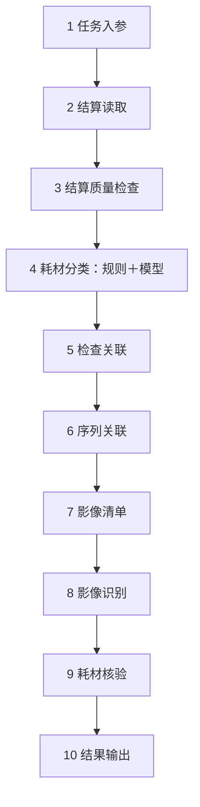

# 髋膝核心流程：ClassificationSignals 说明、42 节点盘点与精简方案

> 实施更新（2026-10-14）：用户随后授权修改代码，已另建并运行 10 节点精简画布。本文保留设计阶段的现状盘点和决策记录；下文“本轮不改代码／待实施”指当时的设计阶段。最新实现、验收证据和实际边界见 [精简流程实现与验收](CORE-COMPACT-IMPLEMENTATION.md)。原 42 节点画布仍保留。

日期：2026-10-14。依据：直接读取运行中平台保存的画布 `e55b03b0-7c7f-420b-b720-33b1a4cf5559`、实际任务 `34daafef-3b63-4b3f-8c2e-55d18bc7bee8` 的节点数据集，以及表单、字段推导和执行代码。

本文区分**已实现的 42 节点现状**和**待实施的精简方案**。用户本轮明确要求“先出详细精简方案，本轮暂不改代码”。本轮只读取配置、复核结果、局部验证现有表达式并编写文档，没有修改执行代码、已保存画布、发布版本或数据源。当前画布仍为 42 个节点。

## 一、第四个节点 ClassificationSignals 是什么

它是 Business Transform（字段转换）节点的一个实例。ClassificationSignals 是本画布给它起的名字，意思是“生成分类线索”。它不读取另一张表、不调用模型、不筛除记录，也不直接输出最终髋／膝类别。输入为 SettlementChecks 的 Valid 数据集。

### 配置说明

| 表单配置 | 实际含义 | 当前填写情况 |
|---|---|---|
| Select | 选择需要保留的上游字段 | 未配置，因此保留上游全部字段 |
| Transforms | 要新增或变换哪些列 | 4 项，分别生成下面四个布尔标记 |
| Field | copy、cast、map 操作的来源字段 | 4 项均为 expression，不使用这个单字段绑定 |
| Output | 生成的输出字段名 | rule_hip、rule_knee、rule_other、rule_conflict |
| Operation | 怎样处理字段 | 全部选择 expression（表达式） |
| Expression | 计算新字段的具体规则 | 引用现有字段并判断文本内容 |
| Type / Precision / Scale | 转换类型、数值精度和小数位数 | 供 cast 使用；本节点不需要配置 |
| Mapping | 旧值到新值的显式映射 | 供 map 使用；本节点不需要配置 |

现有通用表单把不同操作的配置都列出来，因此 expression 操作下也可能看到不需要填写的 Field、Type、Mapping 等项目。这是表单过于通用造成的配置负担，不代表分类需要填写这些项目。

### 四个实际输出标记

以下“耗材字段”均指 PRODNAME、HOS_PROJ_NAME、MEDINS_LIST_NAME。

| 输出字段 | 类型 | 当前准确规则 | 不代表什么 |
|---|---|---|---|
| rule_hip | boolean | 任一耗材字段包含“人工髋关节” | 不表示已经完成最终业务核验 |
| rule_knee | boolean | 任一耗材字段包含“人工膝关节” | false 不表示一定不是膝关节耗材 |
| rule_other | boolean | 任一耗材字段全文等于“非关节耗材（模拟对照项）” | 只是明确的模拟对照规则，不是完整其他耗材目录 |
| rule_conflict | boolean | 同时命中髋和膝；或同时命中明确其他与髋／膝；或材料命中髋但 HILIST_NAME 含膝；或材料命中膝但 HILIST_NAME 含髋 | 不是对所有名称歧义的完整语义判断 |

`contains` 表示包含指定文字，`or` 表示任一字段满足即可，`coalesce(字段, '')` 将空值按空文字参与规则判断。比如：

```text
contains(coalesce(PRODNAME, ''), '人工髋关节')
```

只表示“PRODNAME 中是否包含人工髋关节”。不依据数量或价格猜分类，也没有把手术名称直接当成耗材名称。

后续 NameRules 才将这些标记合成为类别和依据；NeedsModel 根据规则能否确定来分流。ClassificationSignals 与后续这些节点共同完成一件“耗材分类”业务，它不适合长期作为业务使用者必须理解的独立配置步骤。

## 二、下拉字段究竟来自哪里

这几个概念需要区分：

| 内容 | 来源 | 本节点中的例子 |
|---|---|---|
| 数据库原字段 | 数据库元数据中确实存在的列，经 Settlements 读取、SettlementChecks 传递 | PRODNAME、HOS_PROJ_NAME、MEDINS_LIST_NAME、HILIST_NAME |
| 上游新增字段 | 上游节点真实声明并产生的派生列 | SettlementChecks 产生的身份、问题类型等辅助字段 |
| 当前节点新增字段 | 本节点的 Output 配置定义并由表达式计算 | rule_hip、rule_knee、rule_other、rule_conflict |
| 操作名称 | 节点内置能力列表，不是业务数据字段 | copy、cast、map、expression |
| 匹配文本 | 本流程的规则配置值，不是数据库列名 | “人工髋关节”“人工膝关节” |

**Field / Select 下拉的直接来源是“已连线上游输出的数据结构”。** 在本节点中就是 SettlementChecks.Valid。它不是任意预置的一套医院字段，也不是把数据库的每张表都混进下拉。

- 配置时：后台先从实际数据库元数据获得源字段，再按画布连线推导上游节点会输出哪些字段。因此不必运行整个 workflow 才能提供字段下拉。
- 运行时：读取本次任务上游已经保存的数据集，按每行实际值计算。
- 当前节点的 Output 属于“要创建的新列名”，允许命名；表达式引用的输入列必须存在。生成 rule_hip 不需要在结算数据库增加同名列。
- Expression 目前是表达式输入框；其中输入字段必须通过预检。它不是“选任何不存在的列也能执行”。

所以，“来自上游节点”和“运行时来自上游保存结果”是同一条数据链在配置阶段、执行阶段的两种描述。

## 三、输出和单独验收

只有一个 Data 输出。输出保留输入记录和字段，再增加四个 boolean 标记；不改变 CNT、PRIC，不丢掉规则暂未识别的记录，不产生模型置信度，不更新源数据库。

已读取实际任务中的 ClassificationSignals.Data，数据集 ID 为 `0a6507a4-c77c-40ad-9ce6-f25bc3599c48`，共 2 行：

| 原始明细 | 耗材描述 | rule_hip | rule_knee | rule_other | rule_conflict |
|---|---|---|---|---|---|
| MOCK-DETAIL-HIP | 人工髋关节（模拟A型号） | true | false | false | false |
| MOCK-DETAIL-KNEE | 膝关节假体系统（模拟成套产品B） | false | false | false | false |

第二行全 false 的准确含义是“这些字符串规则没有明确命中”，不是“膝关节判断失败后排除”。后续仍可交模型识别。

### 在页面核对现有实际结果

1. 打开[已完成任务](http://localhost:3000/business/tasks/34daafef-3b63-4b3f-8c2e-55d18bc7bee8)。
2. Dataset 下拉选择节点 ClassificationSignals 的 Data 输出。
3. 核对总行数仍为 2，四个标记与上表一致，源名称、CNT、PRIC 保留。
4. 选择上游 SettlementChecks 的 Valid 数据集，按 SETL_FEE_LIST_ID 对照输入、输出。

这是复查已保存结果，不会重新调用模型。现有 Business 执行方式通过已发布任务运行，不能把普通节点上的三角按钮当成已具备独立数据集调试功能。

### 真正只执行这一步的局部验收

本轮已用实际保存的 `transforms` 配置，在现有 DuckDB Transform 执行器中完成 8 组小样本验证，全部通过：明确髋、明确膝、全部空值、规则未覆盖名称、明确其他、髋膝同时命中、手术与材料矛盾、其他与关节同时命中。没有连接模型或请求影像 API。

已同时核对：一入一出，源字段和数价不变，四个标记符合规则；未命中记录仍保留；引用不存在的输入字段会被执行器拒绝。这只验证本节点的现有规则行为，不代表 10 节点方案已经实现或验收，也不代表这些字符串规则覆盖了真实业务中的全部名称。

验收记录：[classification-signals-local-check.json](evidence/core-node-review-20261014/classification-signals-local-check.json)。

## 四、42 个节点按类型统计

| 节点类型 | 数量 | 本画布实例 |
|---|---:|---|
| Business Task Start | 1 | Task Start |
| Business Database | 3 | Settlements、Studies、Series |
| Business Validate | 8 | SettlementChecks、StudyIdentity、StudyChecks、SeriesIdentity、SeriesChecks、ImageChecks、EvidenceChecks、ObservationChecks |
| Business Transform | 14 | ClassificationSignals、NameRules、RuleClassification、ModelEvidence、ModelClassification、UnitContext、StudyContext、CheckTime、StudyBodyPart、SeriesContext、ImageContext、ObservationInput、Amounts、ResultFields |
| Business Filter | 4 | NeedsModel、TargetNames、Undetermined、JointStudies |
| Business Model | 1 | NameModel |
| Business Union | 2 | ModelResponses、Classified |
| Business Output | 2 | ClassificationResults、Results |
| Business Join | 3 | SettlementStudies、StudySeries、UnitEvidence |
| Business API | 1 | Images |
| Business Aggregate | 1 | Manifests |
| Business Imaging | 1 | Observation |
| Business Compare | 1 | CompareQuantityFee |
| **合计** | **42** | **13 种节点类型** |

其中 Transform＋Validate 已有 22 个，占一半以上。业务并没有 42 个独立环节；大量数量来自内部数据处理步骤被暴露为画布节点。

## 五、每个实例具体做什么

| 序号 | 实例 | 作用 |
|---:|---|---|
| 1 | Task Start | 提供监管任务收到的医院、起止时间、规则和任务标识 |
| 2 | Settlements | 从 PostgreSQL 读取指定医院、期间、医保支付、医用耗材、非退费结算记录 |
| 3 | SettlementChecks | 基础质量、必填项、数值及业务身份检查，重复只计算一次 |
| 4 | ClassificationSignals | 生成髋、膝、其他、冲突四个规则标记 |
| 5 | NameRules | 根据标记得出规则类别和引用字段、原文 |
| 6 | NeedsModel | 将规则无法确定的记录分给模型 |
| 7 | RuleClassification | 将规则结果整理成统一的分类结果字段 |
| 8 | NameModel | 调用 SiliconFlow，结合名称及耗材信息辅助分类 |
| 9 | ModelResponses | 合并模型正常输出和问题输出，保留未确定记录 |
| 10 | ModelEvidence | 检查模型引用、类别、置信度范围及冲突 |
| 11 | ModelClassification | 将模型结果整理成统一分类字段，无有效依据时保留无法确定 |
| 12 | Classified | 合并规则分类和模型分类 |
| 13 | ClassificationResults | 单独保存可查看的分类、理由及置信度结果 |
| 14 | TargetNames | 只让明确髋／膝类别进入关节核验 |
| 15 | Undetermined | 区分明确其他与无法确定，用于记录排除／未比较去向 |
| 16 | UnitContext | 建立耗材单位追溯编号，记录套的约定，计算结算数量×单价 |
| 17 | Studies | 从 MySQL 检查表读取同一医院、监管起止期间的检查 |
| 18 | StudyIdentity | 检查表必填项及医院＋系统＋检查号的身份检查 |
| 19 | SettlementStudies | 按医院＋系统＋申请单号关联结算和检查 |
| 20 | StudyContext | 整理关联后的源字段、检查编号和就诊类型，准备检查时间时区 |
| 21 | CheckTime | 将检查时间转换成可以比较的日期时间类型 |
| 22 | StudyChecks | 核对匹配、患者、就诊、DR 模态及检查早于结算时间 |
| 23 | StudyBodyPart | 计算检查部位是否与髋／膝目标类别一致 |
| 24 | JointStudies | 保留部位匹配的检查 |
| 25 | Series | 从 MySQL 序列表读取本轮模拟序列数据 |
| 26 | SeriesIdentity | 检查序列必填标识及医院＋系统＋序列号身份 |
| 27 | StudySeries | 按医院＋系统＋ris_study_id 关联检查和序列 |
| 28 | SeriesContext | 提取 global_id 作为 series_id，整理 link_id、模态和耗材追溯编号 |
| 29 | SeriesChecks | 检查关联成功、编号非空、link_id 一致和 DR 模态 |
| 30 | Images | 使用 series_id 调用影像列表 API |
| 31 | ImageContext | 将 domain＋file_path 拼成影像引用，并恢复耗材追溯编号 |
| 32 | ImageChecks | 检查必要的影像字段和引用 |
| 33 | Manifests | 按耗材单位收集多张影像形成清单 |
| 34 | UnitEvidence | 将影像清单回连原始耗材单位，避免多图重复计算耗材金额 |
| 35 | ObservationInput | 整理传给影像观察的字段，恢复原始业务名称 |
| 36 | EvidenceChecks | 确认已关联到非空影像清单 |
| 37 | Observation | 调用独立影像观察接口；本轮仍为模拟识别 |
| 38 | ObservationChecks | 检查识别确认、覆盖确认、数量、计量单位和依据 |
| 39 | Amounts | 按独立识别数量×源单价计算观察侧金额 |
| 40 | CompareQuantityFee | 比较类别、数量、金额，输出一致／差异及差值 |
| 41 | ResultFields | 给三项比较结果改成清晰的业务字段名 |
| 42 | Results | 保存最终输出并声明任务覆盖核算范围 |

## 六、为什么会拆成 42 个

这版实现为了先验证执行器和每一步追溯，使用现有最小粒度的通用节点拼装。能执行和可追溯不等于业务配置体验合格。主要问题是：

1. **一个分类步骤被拆成 12 个节点。** 使用者需要懂四个内部标记、两种 Union、模型响应字段与统一输出字段。
2. **关联后字段前缀、类型、时间和业务检查分散。** 检查关联占 8 个节点，序列关联占 5 个节点。
3. **影像清单整理占 7 个节点。** 多图归并和避免数价重复是必须的正确性约束，但不应要求业务用户手工搭出这些技术步骤。
4. **独立输出和改名增加画布节点。** 中间结果本可通过任务详情查看；为了查看分类结果而再加 Output，并非业务必然要求。
5. **通用表单展示无关配置。** 表单和节点数量共同增加了学习负担。

不能通过删除去重、关联范围、模型依据检查、计量单位检查或金额去重来压低数字；也不应把 42 个步骤照搬进隐藏子流程后宣称配置已经简化。

## 七、建议的最小业务搭建版本：10 个节点

这是**待实施方案**，不是左侧已经存在的全部能力。新增或增强后，业务使用者配置的是源字段、关联关系和业务要求，内部自动处理别名、类型、追溯与结果整理。首次保留用户正在逐个理解的前三个节点。

| 顺序 | 节点／能力 | 用户需要配置 | 替代的现有工作 |
|---:|---|---|---|
| 1 | Task Start | 无手工参数定义，查看接收契约和某次任务 | 现有 Task Start |
| 2 | Settlements / Business Database | 连接、Schema、表、医院和期间及固定条件 | 现有 Settlements |
| 3 | SettlementChecks / Business Validate | 必填、身份字段和基础质量规则 | 现有 SettlementChecks |
| 4 | 耗材分类 / Business Classification（拟新增） | 手术名／耗材描述字段、类别规则、模型连接；统一结果和依据自动生成 | 现有第 4—15 个节点；追溯编号由系统维护 |
| 5 | 检查关联 / 关联数据库读取 | 检查表连接、医院／系统／申请单关联、时间条件、患者／就诊／模态／部位检查 | 现有第 17—24 个节点 |
| 6 | 序列关联 / 关联数据库读取 | 序列表连接、医院／系统／检查关联、global_id/link_id 映射及一致性 | 现有第 25—29 个节点；与第5步复用同一节点类型 |
| 7 | 影像清单 / Business API 增强 | API 连接、请求参数、影像地址字段；清单收集和原耗材回连自动完成 | 现有第 30—36 个节点 |
| 8 | 影像识别 / Business Imaging 增强 | 服务连接、清单和患者／就诊绑定、观察结果契约 | 现有第 37—38 个节点 |
| 9 | 耗材核验 / Business Compare 增强 | 源分类／数量／单价、观察分类／数量、单位与误差口径 | 现有 UnitContext 中的单位／金额计算及第 39—41 个节点 |
| 10 | Results / Business Output | 要展示的业务结果列，源明细覆盖范围 | 现有 Results；分类依据也可在该节点结果及中间数据中查看 |

按这些职责边界，目标为 **42 → 10**，减少 32 个画布实例，约 76%。检查关联和序列关联复用同一种能力，因此方案为 **9 种类型、10 个实例**。它是保留源配置、质量检查、业务关联与结果可解释性的精简目标；不是数学上不可能再合并。继续压成一两个“一键核验”节点会隐藏所有业务关系，不利于用户逐步理解和复用。

分类、关联、清单、核验节点内部仍应保存可追溯的阶段结果；“不要求用户搭建一个技术节点”和“删除这个检查或数据集”是两回事。正常画布不展开退费、人工处理、重试等异常支路，但不能让问题记录冒充通过。

### 顺序与实际数据来源



这 10 个方框才是用户需要搭建的节点。外部数据源在对应节点中配置：第 2 步使用 PostgreSQL 结算表；第 5、6 步使用本地 MySQL 的检查表、序列表；第 7 步使用影像列表 API；第 4 步配置文本模型连接；第 8 步配置影像识别服务。数据库连接和模型连接不各自再占一个画布节点。

“检查关联”不是把检查表改回 API，也不是省去检查数据读取。它将读取指定数据库、按业务键关联、核对结果这几项操作放进一个配置面板。

## 八、精简后逐节点配置与输入输出

以下为拟实现的配置契约；中文名称是方案名称，不能据此认为左侧已经能拖出这些新节点。接入新数据源时需要确认绑定；对本次固定模拟流程，模板可预填已有配置，用户主要核对连接和实际字段。

### 1—3：保留已经明确的入口和取数边界

| 步骤 | 核心配置 | 输入与输出 | 自动完成／不再要求用户配置 |
|---|---|---|---|
| 1 任务入参 | 只读输入契约、选定任务的实际参数 | 输入为公共 API 已受理的任务；向后提供医院、开始／结束时间、规则及任务标识 | 不填写 Name、Required、Default、Enum；不再选一次医院；任务参数检查仍在公共 API 层 |
| 2 结算读取 | Connection → Schema → Table；本例 `public.core_flow_settlement_v1`；ORGAN_NAME 引用 hospital_name，UPDATE_TIME 引用 start/end；固定 MED_PAY_FLAG="1"、LIST_TYPE="301"、REFD_SETL_FLAG=0 | 输出查询实际返回的结算明细，保留已有 51 个源字段 | 不新增 OP_EM_MARK=3 条件；不要求用户写 SQL；条件附业务说明，字段从数据库元数据选择 |
| 3 结算质量检查 | 沿用已确认的必填项和业务身份字段；当前身份为 ORGAN_CODE＋DATA_SOURCE＋SETL_FEE_LIST_ID；当前数值条件为 CNT≥0、PRIC≥0 | Valid 提供可继续处理的明细；Issues 保存错误或已合并的重复提示 | 自动维护原始行、业务身份和后续追溯编号；不再单独配置 UnitContext 来复制编号；不在这里筛医保、医用耗材或住院范围 |

第 3 步仍要求 OP_EM_MARK 有值，用于后续与检查就诊类型核对；这与“必须等于 3 才能继续”不同。当前实现数值检查是非负，不是严格大于零；精简不暗中更改这个口径。

### 4：耗材分类（规则＋模型）

**输入**：上一步有效结算明细。**正常输出**：确定为人工髋／膝关节的明细，原字段不变，增加统一分类结果。

| 配置区 | 本例配置 | 是否需要业务用户填写 |
|---|---|---|
| 手术名称 | HILIST_NAME | 选择实际上游字段 |
| 耗材描述 | PRODNAME、HOS_PROJ_NAME、MEDINS_LIST_NAME；SPEC 可作为补充信息 | 选择实际上游字段；空值不能编造补全 |
| 明确规则 | 描述包含人工髋关节／人工膝关节；显示已有明确其他规则及其“模拟对照”性质 | 展示可读的字段、匹配方式、值、对应类别；不写 rule_hip 等内部表达式 |
| 模型服务 | 已配置的 SiliconFlow 连接，DeepSeek-V4-Flash；规则无法确定时调用 | 选择连接和模型；密钥仍由连接管理保存 |
| 结果依据 | 保留分类方法、理由、引用字段、原文、模型自报置信度 | 由节点统一生成，不手工配置字段改名和合并 |

自动执行现有分类流程：规则判断、歧义分流、模型请求、依据核对、统一输出与去向登记。所有记录使用同一套策略，不能配置成“髋一定规则、膝一定模型”。规则已明确的膝样例也应走规则，规则不认识的髋样例也应进入模型。

主要派生字段沿用现有语义：`target_category`、`classification_method`、`classification_reason`、`classification_evidence_field`、`classification_evidence_text`、`classification_confidence`。规则结果没有模型置信度，保留为空。置信度用于展示，不新增自动通过阈值。

明确其他记录登记为 excluded，无法确定登记为 uncompared；两者及依据都可以在该节点结果中查看。正常主线只接目标耗材输出，不要求用户另搭 Filter、Union、ClassificationResults 才能看这些去向。最终结果的覆盖统计仍需引用这些登记，不能直接丢掉记录。

### 5—6：同一种“关联数据库读取”能力，两个实例

这种节点一边接收上游数据，一边通过配置的数据库读取关联信息。配置中明确区分“上游字段”和“所选数据库表字段”，避免用户混淆来源。条件右侧支持任务参数；检查配置支持上下游字段比较。

| 项目 | 第 5 步：检查关联 | 第 6 步：序列关联 |
|---|---|---|
| 表 | `business_demo.INSPECTION_INFO_RECORD` | `business_demo.SERIES_INFO` |
| 关联键 | ORGAN_CODE → organ_code；SYSTEM_ID → system_id；RPT_NO → rpt_no | 检查侧 organ_code → organ_code；system_id → system_id；ris_study_id → ris_study_id |
| 读取范围 | 同一监管医院，chk_dt 在监管 start/end 内 | 按输入检查的医院、系统、ris_study_id 读取关联序列 |
| 关键返回列 | ris_study_id、link_id、chk_dt 以及患者／就诊／模态／部位列 | global_id、link_id、序列模态及序列身份列 |
| 业务核对 | 关联成功；患者姓名、证件号、就诊编号、就诊类型匹配；DR；检查时间早于 UPDATE_TIME；部位符合目标类别 | 关联成功；ID 非空；序列 link_id 与检查 link_id 一致；DR |
| 输出 | 原结算字段＋关联检查信息，保留原耗材明细追溯关系 | 原结算／检查字段＋关联序列信息，global_id 提供给影像接口 |

自动处理字段重名、时间类型转换、时区、源记录身份与关联状态。界面按“结算字段／检查字段／序列字段”分组显示，用户不再编辑 left_/right_ 前缀。当前 `chk_dt` 来源仍是数据库原值，例如 `2026-09-01 09:01:23`；转换时间类型不等于凭空计算检查时间。

若一条结算关联到多条检查或多个序列，可产生多条关联记录，但每条必须保留同一个源耗材编号。检查数、序列数不是耗材数量，不能据此增加 CNT。第 7 步将影像清单归回该耗材单位。

第 6 步按关联键限制查询是方案中的改进；当前 Series 节点对受控模拟序列表读取全表，再做 Join。后续实现应按键批量查询，不将每条明细变成一次全表扫描，也不靠写死两条模拟样本得到“简化”。

### 7：影像清单

**输入**：带原耗材追溯关系的序列数据。**输出**：每个源耗材单位一条记录，包含原结算字段与 `image_manifest`。

需要配置：影像 API 连接、请求路径、`series_id ← global_id`、`url_type=3`、返回列表位置 `data`、地址字段 `domain` 和 `file_path`，以及影像唯一标识字段。本例保留当前 `/api/v2/storage/dicom/sop-instance-uid` 接口契约。`study_primary_id` 的来源仍是检查表 link_id；不额外发明接口不需要的请求参数。

自动完成：请求及响应契约检查、`domain + file_path` 拼接、按源耗材收集影像清单、带回原始结算与分类依据。实现时应明确同一影像标识重复返回的处理，避免重复请求或重复清单项；不能仅按全局 URL 合并不同患者／检查的上下文。

示例：同一条结算 CNT=1，关联到 2 张影像，输出仍是 **1 条耗材记录＋2 个影像引用**，不是两条各收费一次的记录。正常搭建不再需要 ImageContext、Manifests、UnitEvidence、ObservationInput 这些辅助节点。

### 8：影像识别

**核心配置**：识别服务连接、影像清单字段、医院／患者／就诊字段、目标类别和计量单位绑定。当前接口保持模拟服务；精简画布不等于已经接入真实影像识别模型。

**自动完成**：调用独立观察服务，并核对返回的识别确认、覆盖确认、类别、数量、单位和依据。输出保留源数据并增加 `recognized_category`、`recognized_quantity`、`observed_unit`、`evidence_ref` 等结果。

现有 ObservationChecks 的检查合并在节点内部，不能删去；观察侧数量仍须来自独立识别结果，不能把 CNT 复制成识别数量来制造一致。

### 9：耗材核验

| 核验项 | 源侧 | 观察侧 | 本轮口径 |
|---|---|---|---|
| 类别 | target_category | recognized_category | 按人工髋／膝所属类别比较 |
| 数量 | CNT | recognized_quantity | 双方单位为套，差值容忍度 0 |
| 金额 | CNT×PRIC | recognized_quantity×PRIC | 单价元／套，差值容忍度 0；不是核对独立原始账单金额 |

用户绑定类别、数量、单价等业务字段，看到单位和比较口径；无需增加 Amounts、ResultFields。节点自动生成结算侧金额、观察侧金额、数量／金额差值，以及 category_status、quantity_status、amount_status 三项清晰结果。

原 CNT、PRIC 必须原样保留，单位与金额口径为现有已确认的模拟约定。精简不把数量差与金额差混为一项，也不增加新的金额源字段。

### 10：结果输出

选择需要展示的业务结果列、源明细和证据。模板预填现有 Results 列及统计口径；自动关联结算质量、分类及各关联步骤的处理去向，维持本次查询实际返回范围的覆盖核算。

主结果显示最终核验的耗材；节点详情保留中间记录、分类依据和模型置信度。明确其他、无法确定、数据错误不能因没有进入主结果就消失，也不需要用户为了保存这些记录额外画一条异常处理流程。

## 九、合并核算与不变的业务约束

| 当前部分 | 旧节点数 | 方案节点数 | 说明 |
|---|---:|---:|---|
| 入口、结算读取、结算检查 | 3 | 3 | 保留独立职责 |
| 分类：第 4—15 个实例 | 12 | 1 | 规则、模型、依据和去向由同一节点处理 |
| UnitContext | 1 | 0 | 追溯由系统维护；单位在识别／核验契约中沿用；金额在核验节点计算 |
| 检查关联：第 17—24 个实例 | 8 | 1 | 数据库读取与关联检查一起配置 |
| 序列关联：第 25—29 个实例 | 5 | 1 | 复用关联数据库能力 |
| 影像清单：第 30—36 个实例 | 7 | 1 | 请求、地址、收集及原耗材回连一起完成 |
| 影像观察与返回检查：第 37—38 个实例 | 2 | 1 | 输出契约内置检查 |
| 金额、比较和改名：第 39—41 个实例 | 3 | 1 | 输出可直接理解的业务结论 |
| 最终结果 | 1 | 1 | 保留 |
| **合计** | **42** | **10** | **没有遗漏旧节点** |

保留以下口径：医保支付、301 医用耗材、非退费；不限制必须住院；结算和检查分别使用监管提交的同一 start/end；医院＋系统范围限定关联；真实字段绑定和派生字段说明；规则＋真实在线文本模型辅助；模型引用核对；数量单位套；domain＋file_path；每条耗材只核验一次；来源、依据与覆盖可追溯。不增加目录数据库，不新增退费或人工处理分支。

“本轮不做异常分支”指不展开人工处置、补偿、重试等流程；不会删去保障核心结果正确的检查。新节点内部产生的 Issues 和处理记录需仍可查看。

## 十、后续实施顺序与验收计划（本轮不执行）

| 阶段 | 后续工作 | 必须看到的验收结果 |
|---|---|---|
| 1 分类合并 | 实现耗材分类节点的表单、运行和阶段结果查看；复用现有规则与模型逻辑 | 现有 12 个分类实例由 1 个取代；明确髋和明确膝都能走规则；未覆盖的髋／膝均能走模型；引用、置信度和无法确定去向保留 |
| 2 数据关联合并 | 实现关联数据库节点，分别配置检查、序列 | 8＋5 个实例由 2 个取代；上游／数据库字段来源清楚；医院、系统、申请单／检查号关联及时间核对不变 |
| 3 影像与核验合并 | 增强 API 清单整理、Imaging 输出检查和 Compare 计算比较能力 | 7＋2＋3 个实例由 3 个取代；多图不重复计算 CNT／金额；独立识别结果和三项比较可追溯 |
| 4 新画布与结果贯通 | 在新草稿中组合 10 个节点；维护源身份、处理去向和 Results 覆盖统计 | 原 42 节点版本保留可对照；新草稿通过结构和字段预检；不存在用户手工操作内部技术列的要求 |
| 5 真实执行与界面验收 | 使用同一批模拟数据运行新版本，核对任务、节点详情、输入输出与最终结果 | 两个正常样例都到达最终结果；文字分类按需真实调用指定在线模型；数据库真实查询，影像 API／识别仍明确标为模拟；结果与旧版逐条一致 |

### 精简版最终验收条件

- 主画布不超过上述 10 个业务步骤；不要求使用者编辑内部变量、left_/right_ 前缀、复杂布尔表达式或改名节点。
- 输入字段从实际数据库／API 契约／上游输出中选择；派生字段有清楚说明。
- 规则明确的记录不调用模型；规则未覆盖的正例真实调用指定模型；不丢掉无法确定记录。
- 同一医院、系统及申请单／检查号的关联约束保留；监管起止时间语义保留。
- 2 条结算、2 条检查、2 条序列、4 条影像仍输出2份耗材单位结果；不得把多张影像变成多次计费。
- 两个既有正常样例的类别、数量、金额仍全部一致，覆盖缺口0；原始CNT、PRIC不被修改。
- 在界面能看字段来源、分类理由、模型置信度和逐节点结果；新画布与旧画布版本可对照。

上述验收为后续实现的完成标准，本轮没有宣称通过。当前已完成的是 42 节点事实盘点、ClassificationSignals 现有规则局部验证和这份详细方案。若后续仅允许组合现有通用节点而不增加这些业务能力，不能保证仍为 10 个节点且有同等配置体验。

## 十一、三层复用边界与左栏调整建议

补充日期：2026-10-14。用户继续要求只讨论设计、不改代码。本节澄清上一版“业务步骤名称”与“节点类型”混写的问题；下列新增及增强仍为建议，未实施。用户对设计含义的询问不视为代码实施授权。

### 基础能力＋业务配置模板＋完整流程模板

| 层次 | 职责 | 髋膝例子 | 变化边界 |
|---|---|---|---|
| 基础能力 | 以字段和规则配置驱动的读取、关联、校验、分类、比较、输出等能力 | 数据库关联读取 | 不把医院、表名、申请单列名、髋膝类别或 DR 写成通用节点的固定业务要求 |
| 业务配置模板 | 对某个业务步骤预填适用字段、判断规则、类别或比较口径 | 按医院＋系统＋申请单关联检查；数量单位套 | 配置可见、可调整；数据源变更后仍须确认字段来源和含义；预设不保证对任意新数据正确 |
| 完整流程模板 | 将所需能力及配置组织成完整业务样例 | 约 10 个节点的髋膝核心流程 | 其他业务可以删去影像步骤、采用不同顺序或增加所需能力；不强制共用这 10 步 |

三层是职责划分，不要求为了此次精简新增三个独立管理系统。业务配置模板可以先采用与节点配置结构一致的预设，完整流程模板保存节点及连接配置。

本轮代码核对：普通模板及 Business 模板均通过模板内容创建独立流程／方案草稿，模板修改不会自动更新已创建流程。Business 已有完整图模板和独立连接资源；在已核对的 Business 前后端及模型中，未发现独立保存、选择并套用业务配置预设的资源和入口。因此中间层目前可以体现在流程模板预填的节点配置中；独立预设复用仍是拟补充能力。独立画布副本不表示它引用的连接等共享资源也被复制。

依据：`src/frontend/src/modals/templatesModal/components/TemplateContentComponent/index.tsx`、`src/frontend/src/hooks/flows/use-add-flow.ts`、`src/frontend/src/pages/BusinessPage/Schemes.tsx`、`src/backend/base/langflow/business/templates.py`、`src/backend/base/langflow/business/models.py`。

### 左栏建议：新增两种能力，保留基础节点

| 节点类型 | 建议动作 | 髋膝实例数 |
|---|---|---:|
| Business Task Start | 保留 | 1 |
| Business Database | 保留 | 1 |
| Business Validate | 保留，维持业务身份和追溯 | 1 |
| Business Classification | 新增规则＋模型分类能力，类别、字段、规则和模型可配置 | 1 |
| Business Database Lookup | 新增数据库关联读取能力，表和关联／核对条件可配置 | 2 |
| Business API | 增强可选的结果字段组合、按源记录收集清单能力 | 1 |
| Business Imaging | 增强输出契约检查，保留专业服务边界 | 1 |
| Business Compare | 增强简单计算、比较与业务结果命名 | 1 |
| Business Output | 保留并衔接结果去向和覆盖统计 | 1 |

这张画布合计 9 种类型、10 个实例，不表示整个左栏只有 9 种类型。已有 Transform、Filter、Join、Union、Aggregate、Model 等仍可用于自由搭建；不为每个耗材类别新增专用节点。API 清单整理等增强应显式配置，不能强制改变已有节点的普通行为。

### 通用性承诺的准确范围

- 已有能力范围内，换业务应尽量通过更换数据源、字段绑定、规则、类别和流程组合完成。
- 影像识别等专业能力有适用范围；新增专业算法或已有节点无法表达的处理，仍可能需要开发新能力。“可扩展”不等于未来所有业务都无需代码。
- 10 个节点是当前髋膝正常核心流程的目标，不是平台限制，也不是所有业务的固定节点数量。
- 精简不能删去源身份、证据、必要核对或中间结果。原先分散的技术处理移入能力内部，业务配置仍可查看。
- 模板降低搭建成本，但不免除数据源绑定和业务验收；两条受控模拟样例通过不证明真实影像识别效果。

### 设计确认树（本轮范围）

- 当前要澄清的主干：三层各自负责什么、左栏与画布实例的区别、通用性及专业能力的边界，见本节。
- 已提出但未实施的方案：新增两类能力、增强现有节点、提供髋膝完整流程模板；不重写整个节点库。
- Q24 已确认：用户选择“先验收髋膝流程，跨业务验证以后做”。首轮验收范围为髋膝正常核心流程，不增加订单／商品等跨业务执行验证。通用字段绑定、规则配置和可扩展边界仍是设计要求。
- 验收声明边界：首轮通过后只能声明髋膝流程通过，不能声明跨业务复用已实测。后续跨业务验证另行开展，当前不虚构完成时间或验证结果。
- 实施状态：本轮仍只完善方案，不将设计讨论或 Q24 的选择视为启动开发。
