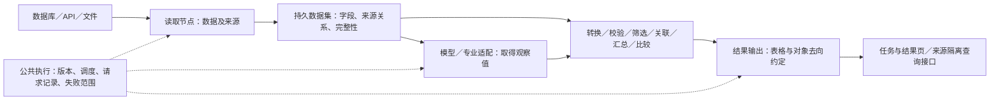
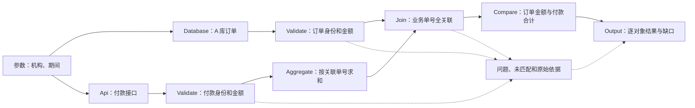
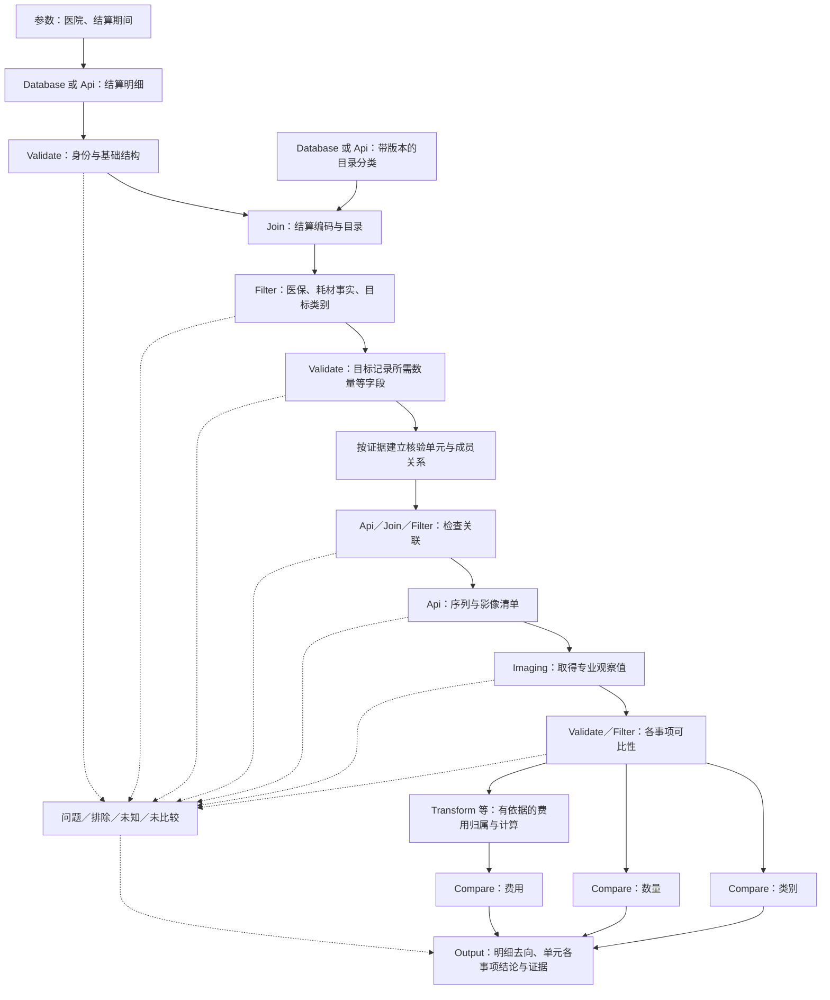

# 通用数据处理与业务核验平台：改造实施方案

日期：2026-10-10。依据：[D01—D07 决策记录](./REFACTORING-PLAN.md)、[第一性原理审查与消融实验](../../spikes/001-business-architecture-ablation/README.md)、[业务词汇表](../../CONTEXT.md)。

**状态：D01—D07 对应的工程改造已落地，实际验证范围见[改造验收记录](./REFACTORING-ACCEPTANCE.md)。** 本文保留设计依据与目标契约；不能将设计中的全部协议能力或真实业务效果视为已经验收。节点配置分组、数据契约和实施步骤是依据已确认选择作出的工程设计，不冒称每个字段都经过用户单独确认。真实接口、比较口径和专业效果的缺口仍见第 11 节。

## 1. 改造结论与实施范围

平台继续提供可组合能力。具体业务由节点、连线、节点配置及数据定义；高值耗材保留为模板和可选专业能力。保留现有 Langflow 画布、图调度、后台 Job、持久数据集、DuckDB 运算、连接管理和来源授权，围绕已发现的错误边界改造，不整体重写平台。

| 已确认选择 | 本方案的实现责任 |
|---|---|
| D01：按方案声明结果交代义务 | 普通处理可仅输出清单；核验方案必须声明对象和事项，公共机制核对最终去向 |
| D02：明细去向＋单元结论 | 保留原始记录、业务身份、分组成员和结果之间的关系；单元差异只计算一次 |
| D03：按依赖影响范围隔离失败 | 独立部分继续；依赖不完整来源、冲突事实或缺失证据的结论停止形成 |
| D04：完全重复合并，事实冲突阻断 | 原始出现全部保留；同身份同事实只参与一次计算；禁止任意保留冲突中的一条 |
| D05：按模型实际能力接入 | 发送前登记独立请求；可接同步服务；远端未知不自动重提，不形成相应有效结论 |
| D06：维护窗口内排空升级 | 单一执行构建；原环境处理完已受理任务，再升级、验证和重新发布受影响方案 |
| D07：分阶段验收 | 分别交付工程能力、真实接口接入和真实业务效果；不能将前一阶段通过当作全部完成 |

本期仍为单部署，数据库支持 MySQL、PostgreSQL。百万行数据分批读取和持久处理，浏览器分页展示。不新增微服务、第二套图执行器、分布式计算、模型训练、源业务库写入或自动恢复系统。已有节点类名和保存流程的组件标识保持稳定；节点能力的调整通过配置契约版本和明确迁移实现。

## 2. 从第一性原理划分责任

核验的最小责任链是：取得依据，确认对象与范围，检查能否比较，执行确定性比较，交代全部应交代对象的结果或缺口。每一项责任必须有承担者，但不要求每项责任都新建一个可拖拽节点。

| 边界 | 负责 | 不承担 |
|---|---|---|
| 连接管理 | 地址、协议、凭据引用、可访问资源和服务能力说明 | 本方案筛选哪些类别、核验哪些事项 |
| 读取适配 | 按固定查询契约读取，保留来源与完整性依据 | 依据项目名称猜测分类，得出业务结论 |
| 通用数据运算 | 按声明字段进行校验、关联、汇总、比较 | 内置医院、髋膝、患者或订单的分支条件 |
| 专业能力 | 解码、识别、专业计量或复杂关联，返回观察值及依据 | 静默代替模板选择监管范围，独占任务／版本／授权机制 |
| 业务模板 | 业务字段、范围、对应关系、可比性条件、结果意义 | 复制另一套任务执行器或连接凭据 |
| 公共执行与结果 | 固定版本、安排执行、留存请求和证据、检查声明的覆盖 | 从任意连线自动猜出未声明的业务目标 |

低耦合不是没有数据依赖。更换数据源应只调整连接及字段绑定；更换模型应只调整相应适配及输出绑定；修改目标类别应只改模板条件。来源、字段、问题记录等共同契约不随业务名称改变。

## 3. 节点目录、边界与最小性

### 3.1 沿用节点类型，调整必要能力

以下是能力目录，同一类型可以使用多个实例。对应配置通过画布的“业务配置”面板提供，实际支持范围及限制见改造验收记录。

| 节点 | 配置入口与主要配置 | 输入 → 输出 | 明确边界及本次动作 |
|---|---|---|---|
| Business Parameters | 参数名、类型、必填、允许值、默认值 | 外部参数 → 已校验参数对象 | 保留现有节点；不把医院、期间设为平台必填参数，也不再建一份流程属性参数表 |
| Business Database | 已登记数据库连接、表／视图、条件、参数绑定；高级 SQL | 参数 → 原始数据集及结构 | MySQL/PG 共用这一类型；分批读取，不做业务分类；表模式保留返回全部列 |
| Business Api | API 连接、路径、方法、字段绑定、记录路径、分页与完整性约定 | 参数或逐对象输入 → 数据集、问题及读取范围说明 | 与数据库读取分开；共用数据集契约；逐对象失败按范围隔离，不能把网络失败当空结果 |
| Business File | 文件、格式、编码、字段声明 | CSV／JSON／Parquet → 原始数据集 | 保留可选能力；结构漂移必须显式报出；上传大小限制不等于整个任务规模上限 |
| Business Transform | 重命名、显式类型／单位／时区转换、值映射、受限表达式 | 数据集 → 派生数据及转换问题 | 不覆盖原始快照；转换失败不得被改成零或 false，不能再被汇总静默忽略 |
| Business Validate | 必填、类型、范围、字段约束；业务身份、完全重复与冲突处理 | 数据集 → 合格、问题、重复记录关系 | 扩展现有校验职责承担 D04；校验业务身份不等于判断医学可比性 |
| Business Filter | 字段、运算符、值、AND/OR 组合及原因标识 | 数据集 → 满足／不满足／未知 | 三态分流；false 是明确不属于条件，unknown 是依据不足，不得合并 |
| Business Join | 左右字段、关联方式、一对一／多对一等基数 | 两份数据 → 对应记录、未匹配及冲突 | 回答谁对应谁；不比较金额，不按行号配对；不将缺失对侧补成零 |
| Business Aggregate | 分组字段、指标及运算、输出名 | 明细 → 汇总及成员关系 | 跨全部读取批次计算；分组正确性由模板依据决定，不能把分页或批次当核验单元 |
| Business Compare | 字段配对、方式、容差、空值和差值方向 | 已满足前提的数据 → 每项比较结果 | 只做确定性运算；比较前提由 Validate/Filter 或专业依据承担，不自己查询证据 |
| Business Model | 模型连接、输入字段、提示词、输出结构及调用粒度 | 字段／文件引用 → 观察值、响应、问题和请求引用 | 保留通用文本分析等能力；输出结构正确不等于事实已被证实 |
| Business Imaging | 专业服务、证据清单、目标与计量口径、专业响应映射 | 影像证据 → 专业观察值及依据 | 保留可选适配；从共用调用函数移出简单业务门槛，专业算法归专业组件／服务；其他流程不依赖它 |
| Business Union | 输入集合、明确字段对应 | 多份同类数据 → 追加数据及来源关系 | 收敛为追加／字段对齐；完全重复和冲突统一交给 Validate，不再独立按 UUID 选一条 |
| Business Output | 表名、列、标识、原因和证据；主输出中的结果交代约定 | 结果数据 → 可查询结果及最终覆盖核对 | 一个方案只有一处主结果交代约定；可有多个输出表，不为每张表另造覆盖义务 |
| Business Subflow | 已发布子版本、输入与输出绑定 | 参数／数据集引用 → 子流程结果及来源 | 保留可选复用能力；不读取最新草稿，不另建任务授权体系，保留调用路径避免节点身份碰撞 |

Validate 的业务身份配置可命名一个对象，例如 `settlement_detail`，包含来源命名空间和身份字段。Output 引用该定义，不能再填另一套身份键；普通数据校验也可不声明业务对象。核验方案还要在 Output 中引用该对象的原始读取起点，使身份缺失、转换前出错的原始记录也纳入交代范围。

这里 Validate 的责任是确保每个已声明身份只有一份无冲突的可用事实；完全重复折叠属于该约束的处理方式，所有出现仍有去向。它不接管 Union 的多来源追加，也不接管 Filter 的业务范围选择。

Union 的旧 `deduplicate=true` 配置不能静默忽略或继续沿用任意取值。新发布检查指出迁移位置：保留追加节点，增加／配置后续身份校验并接出问题分支。已发布旧版本保持不可变，按 D06 排空和重新发布；不重写历史结果。首期不新增专用 Deduplicate 类型，不同时维护两套重复判定算法。

### 3.2 对“最小节点集合”的回答

**当前侧栏的 15 种类型是可用能力目录，不是高值耗材必须逐个使用的清单，也尚未被证明是全局最小集合。**

在“全部来源走 API、字段无需额外转换、没有文件导入或文本推断”的样例前提下，Parameters、Api、Validate、Filter、Join、Aggregate、Imaging、Compare、Output 九种类型可以作为起点。需要金额派生、单位转换时加入 Transform；使用数据库时加入 Database；需要多来源追加时用 Union；复杂画布可用 Subflow。不同类别、数量和费用分支会复用同一类型，节点实例数通常更多。

已由可信上游完成关联或汇总，并提供完整依据时，可减少相应节点实例；责任不能消失。是否可以再删一个实例，必须用本方案的输入契约、正确结果和失败样例对照验证。A11 支持迁移简单门槛，A14 支持减少重复遍历，两者均不能证明完整专业流程的最小性。

### 3.3 Langflow 自带节点如何复用

原生节点可复用协议实现、字段表单、结构化解析和子流程交互，但现有 `Data/DataFrame` 不自动具备业务数据集的持久化、完整性、来源及版本契约。

| 原生能力 | 复用方式 | 必须补齐的边界 |
|---|---|---|
| SQL Executor | 复用连接／查询思路，使用分批读取实现 | 当前 `fetchall()` 路径不能用于百万行读取；不能先全量加载再包成数据集引用 |
| API Request | 复用 HTTP 与鉴权适配能力 | 分页、业务错误、独立请求记录、失败范围、原始响应留存 |
| DataFrame 运算与条件路由 | 复用运算语义及配置交互 | 持久执行、业务键关联、跨批次聚合、三态筛选、精确数值 |
| 模型／Structured Output | 复用模型协议和解析 | 输出合法性、专业依据、持久请求及未知状态；不自动获得 CT/DR 识别能力 |
| Run Flow | 复用子流程交互 | 固定已发布子版本、数据集引用和覆盖关系 |

只有完成适配并注册的能力才能用于正式业务发布。保持组件类名，不能为显示名称调整而破坏保存流程的标识。实现依据见消融报告第 8 节及当前 `business/components.py`。

## 4. 两种业务的组合与数据来源混用

### 4.1 数据库订单＋API 付款

设计人员在订单节点选连接 A、订单表和范围条件；付款节点选 API 连接、路径、参数和分页。付款汇总使用 `biz_no` 与 `paid_amount`；Join 显式绑定订单 `order_no` 与付款汇总 `biz_no`。两边字段名称不需要相同，也不要求来源使用同一种协议。

O001 应付 100，付款 P01=60、P02=40，应得到合计 100。P01 与 P02 是不同付款明细，不能按共同的 `biz_no` 当重复；P01 被 API 重复返回且事实相同时才折叠。O002 应付 200、付款 180，差值按“付款减订单”为 -20。O003 无付款、O004 仅付款侧存在，分别未比较，不能补零。

如果整个付款范围第 8 页失败，不能用前 7 页汇总证明 O001 已足额支付；如果接口提供已约定独立且完整的逐订单查询，只有某订单查询失败，才可隔离该订单。源 API 没有完整性约定时，平台不能只凭“已经读完收到的页”证明业务范围完整。

### 4.2 高值耗材模板

图中一框可对应多个节点实例，虚线是结果关联示意，落地时须有明确数据端口或覆盖绑定；不能靠这张概念图代替实际可执行连线。

校验按使用位置配置：读取后先检查身份与范围判断必需的基础事实，确认目标范围后再检查数量、计量等处理条件。明确不是耗材的检查费不应仅因没有“耗材数量”就被当作目标数据错误；目标记录缺少数量则必须阻断数量核验。与某事项无关的问题仍可留存，但不自动阻断其他有完整依据的事项。

管理员先登记结算数据库 A 和目录 API B。设计人员在两个读取节点分别选择连接，配置目录的编码体系、版本／有效时间，以及结算编码与目录编码的关联。若不同医院使用不同编码体系，Join 必须包含对应的体系或机构字段，不能仅因编码文本相同就认定同一种耗材。

`hip_prosthesis`、`knee_prosthesis` 等目标值只在该模板的 Filter 中配置。目录数据源负责提供“编码属于什么类别”的事实；不要求管理员提前枚举本次任务会出现的每个编码。业务批准的少量纠错可用一份有来源及版本的参考数据显式关联，不能在发布页另写一份映射，也不能按缺少映射自动排除。

当前模板按患者、医院、就诊、类别、单位分组只是现有模拟做法。真实业务可能还需要侧别、手术、计数对象或检查范围；第 11 节确认前，不把这组字段当作已获专业证明的默认值。同一影像 UID 去重，也不能替代多幅影像中同一实物的计数去重。

类别、数量、费用分别检查前提。数量比较要求对象、范围、单位和证据可比；费用还需价格及明细归属。组内价格不同且无法归属时，数量可以有结论，费用必须未比较。所有未知和失败状态均进入最终结果，不仅保存在中间文件。

## 5. 页面与配置位置：只维护一份业务规则

以下路线基于当前已有页面；配置分组及新增摘要为改造目标。

| 页面／位置 | 使用者 → 作用对象 | 配置或查看什么 | 与其他页面的边界 |
|---|---|---|---|
| `/business/connections` 连接管理 | 平台管理员 → 数据库／API／模型连接 | 地址、协议、凭据引用、元数据；模型同步或查询能力 | 只管理如何访问，不管理目标类别和核验条件 |
| `/flow/{flow_id}` 选中读取节点的业务配置面板 | 流程设计人员 → 当前读取实例 | 连接、表或 API、查询范围、分页、参数、目录体系及版本绑定 | 两个读取实例可选择不同数据库或协议；参数不能来自外部任意 SQL 覆盖 |
| 同一画布的 Validate 配置 | 流程设计人员 → 数据校验与对象身份 | 字段要求、业务身份和来源范围、重复处理 | 身份定义只存这里；主 Output 引用它，不重写第二套键 |
| 同一画布的 Filter／Join／Aggregate／Compare 等配置 | 流程设计人员 → 对应操作 | 类别范围、关联键、分组口径、比较字段、容差等 | 不把这些条件复制到发布页 |
| 主 Business Output 的“结果交代约定”配置组 | 流程设计人员 → 本方案结果责任 | 普通输出或逐对象核验；原始主数据起点、身份定义引用、核验事项、单元结果及问题去向绑定 | 可引用多张输出表；一份约定统一核对，其他 Output 只配置自己的结果表 |
| `/business` 业务方案发布页；保留 `/verification` 现有入口兼容 | 管理员 → 方案及发布版本 | 名称、稳定编码、来源授权、草稿、发布说明、版本与启用；自动生成参数、目标类别、分类来源、未知处理和结果结构摘要 | 摘要来自保存的画布及发布包；不提供另一份可编辑的目录映射或筛选条件 |
| `/business/tasks`、`/business/tasks/{taskId}` | 平台人员 → 任务及结果 | 执行、完整性、结果交代、有效结论、动态表格、明细去向、请求与证据 | 原始／中间数据仍可展开；默认结果直接交代业务，不要求到磁盘找文件 |
| `/business/history` 与既有 `/verification/tasks` | 获授权人员 → 旧规则和历史任务 | 历史版本、结果、证据 | 只读，不将旧固定流程重新开放为新任务入口 |

发布页“目标类别”是模板 Filter 值的只读摘要；“分类来源”是相应读取节点的连接名称、编码体系及版本的只读摘要；“未知处理”是模板分支及结果约定的摘要。它们的作用是帮助管理员审核将发布什么，不是第二个规则编辑器。无法从已声明配置可靠生成的语义应标为未声明，不根据节点标题猜测。

字段下拉来自上游输出结构，显示节点来源、字段、类型与注释。数据库使用元数据；API、SQL 和文件按声明及有限预览建立结构，运行时再检查。选择比较字段不删除原始字段。更换连接或表后，旧绑定失效须明确提示，不按同名或近似名静默替换。

字段结构需保留精度、小数位和已声明的时区／单位。金额不能经浮点中转或统一截成固定六位小数；精度损失或溢出必须拒绝，或使用明确批准的转换规则。新增未绑定的来源字段仍保留并报告；消失的已绑定字段或不兼容类型阻断受影响节点，不能用预览样本掩盖实际漂移。

## 6. 数据、身份、完整性与结果契约

### 6.1 节点之间传什么

继续传数据集引用，不传百万行 JSON。现有 `id / fields / row_count / node_id / port` 保留；逐步增加完整性摘要、原始来源和问题范围引用。实际数据、行级来源关系、问题明细及分组成员放在持久数据集中，不塞进任务的一大块 JSON。

| 信息 | 用途 |
|---|---|
| 查询条件、参数、取数时间、连接修订、来源快照依据 | 说明本次读到的是什么，不宣称跨库同一全局事务快照 |
| 原始数据集与行身份 | 即使业务键缺失，也能定位收到的原始记录 |
| 字段结构与派生关系 | 支持下拉、发布检查、运行时类型校验和原值追溯 |
| 范围完整性：完整／不完整／未知／未开始及依据 | 区分空结果、读取失败、部分返回；数据集物理写完不代表业务范围完整 |
| 业务身份、重复出现关系、关联侧与聚合成员 | 从单元结果回查全部来源，且不重复计数 |
| 问题发生位置、原因、影响范围与依据引用 | 决定依赖哪些事实的处理必须停止，不能仅按异常类型猜影响对象 |

全量保存指配置查询实际返回的全部原始字段与记录。SQL 只查询三列只保留那三列；模型只接收配置的必要输入。已持久化的读取批次应封存为可查的已读部分并标注不完整，不能冒充完整数据集；尚未收到或未成功持久化的记录不能声称已保留。读取过程分块落盘，结束后登记范围完整性，不要求百万行全部暂存在内存后统一保存。失败诊断至少交代最后成功批次、已保存数量及失败位置。

继续使用 Parquet 与现有数据集服务；必要的文件分片属于物理保存细节，不新增第二套存储引擎。只有封存成功且可读取的批次／部分文件才算已保存，不能把尚未完整落盘的缓冲区计入快照。影像 URL 属于已返回字段，保存地址不等于保存影像文件本身；下载、证据保留和链接失效按专业服务实际契约明确，不承诺任意未来时点均可重放。

### 6.2 三种身份与 D04 的实施

1. 原始出现身份：数据集及行标识，只定位一次收到的记录，不推断业务是否重复。
2. 业务明细身份：按 Validate 声明的来源范围和业务键确定。同身份、全部原始业务事实相同的多次出现关联到同一明细，后续只计算一次。缺失字段与显式 null 不自动视为相同，格式规范化必须有明确配置。
3. 核验单元身份：本任务中某一声明的比较口径对应的单元，关联全部成员；不能用分页号或可重复的展示名称充当身份。

判定重复须能回到原始业务字段，不能只比较投影后的数量、金额，也不能忽略没有参与比较的冲突字段。实现可用 DuckDB 分组／关联减少内存，但摘要相同不能代替最终事实一致性检查。身份缺失记录逐条保留为问题，不能把所有空键折叠成一个对象。

同键不同事实全部标记冲突；如果冲突涉及分组字段，不能任选一个分组后只阻断它，须阻断能够确认受影响的范围，无法缩小时扩大到分支。Join 的匹配基数仍需独立声明：付款的业务唯一键是流水号，订单关联键是单号，二者不能混用。

### 6.3 结果交代只声明一次，终结时统一核对

主 Output 配置引用：原始主数据读取起点、身份校验定义、单元成员关系、应核验事项、各事项的结果表与状态／原因／证据字段，以及范围排除和成组前问题的结果表。使用现有节点和输出端口选择器，不手填磁盘路径。

编译器验证引用存在、字段兼容、身份与事项唯一、主约定只有一份。普通处理可以只声明目标表；核验模式缺少对象或事项声明不能正式发布。主数据选择错误会影响覆盖，因此发布摘要必须展示所选范围；平台不能自动判断设计人员遗漏了一张真实业务表。

各 Output 先保存自己的结果表。公共任务终结阶段按已发布约定统一核对，不能在第一张输出完成时就宣称所有分支已交代。局部或整体执行失败也应尽力生成已知对象的去向与问题摘要；结果存储自身失败时明确报告摘要不完整，不能伪造结果保存成功。这是任务收尾责任，不是再运行一套业务图。

行级来源必须贯穿 Transform、Filter、Join、Union、Validate、Aggregate 和 Subflow。仅保存父数据集 ID 不足以证明某条记录已有最终去向。复用现有聚合成员数据集，并补齐其他变换的行关系；这些信息由节点运行自动产生，不要求用户另加来源登记节点。

核对时先从已知原始起点建立应交代集合，再关联身份、成员和声明事项，最后检查是否恰有一致的最终状态。缺少状态记覆盖缺口；同一单元同一事项出现相互矛盾的结果记结果冲突，不选最后一条。完全相同的重复结果不重复计数，问题原因可以有多项。读取范围不完整时，还必须同时标注对象发现范围未确认。

例如只讨论数量事项：

| 收到的原始记录 | 明细身份与后续去向 | 最终展示 |
|---|---|---|
| R1、R2：全部业务字段相同，数量各为 1 | 都是 D001，参与 U01，只贡献数量 1 | 两次出现均可追溯，业务明细只计一次 |
| R3：数量为 1 | D002，也参与 U01 | U01 合计 2；若有效识别数量为 1，单元差异为 -1 |
| R4：分类依据缺失 | D003，无法形成已确认的核验单元 | 明细列表直接显示未比较及原因 |

这里是 4 次原始出现、3 个已确认明细身份、1 个已形成核验单元；U01 的 -1 只计一次。不能据“1 个单元已有结论”说所有明细都得到有效核验。

### 6.4 页面和 API 分开表达四类情况

| 维度 | 必须回答的问题 | 不能替代什么 |
|---|---|---|
| 执行 | 等待、运行、本地已结束、整体失败或执行情况待确认；是否有局部执行错误 | 本地结束不等于核验一致；输入数据非法也不必然等于执行器崩溃 |
| 取数完整性 | 每个来源／独立范围是否取齐，凭什么确认 | “收到的全部处理完”不能证明应读取对象已全部发现 |
| 结果交代 | 已知原始记录和对象的声明事项是否有去向；有哪些漏项或相互冲突的结论 | 有明确未比较原因算已交代，但不算有效结论 |
| 业务结果 | 按事项分别统计一致、差异、未比较、明确不适用及原因 | 不能用节点问题行数代替去重后的业务对象数 |

初期复用已有任务状态，并以单独的完整性、覆盖、问题统计响应补充语义；API 增量兼容，避免为了一个“总成功率”混合这些维度。界面可以显示“执行已结束，部分调用失败；数量 80 个有结论、20 个未比较”。

统计分母必须可解释：接收记录数、身份已确定的不同业务明细数、身份缺失记录数、核验单元数分别展示；同一问题经过三个节点不能累计成三个业务对象。按事项，已确定适用范围内的单元数＝有效结论单元数＋未比较单元数；有效结论又区分一致和差异。尚无法判断适用范围或不能形成单元的明细另列，不从分母中悄悄消失。来源范围不完整时，不展示覆盖整批业务的 100% 指标；若展示已知记录的交代率，必须明确只针对已收到的数据。分母为零时不伪造 100%。

### 6.5 依赖失败的最小机制

各节点在数据集之外记录失败所对应的来源、分区或业务对象范围，以及受影响的事实。读取节点只有在源协议与已声明请求粒度支持时，才能声明逐对象独立；平台不提供一个不需依据的“忽略错误继续”开关。

| 故障 | 必须阻断的处理 | 可以保留的处理 |
|---|---|---|
| 结算主范围分页未完成 | 依赖该范围完整数量的汇总和比较；尚未发现的对象总量仍未知 | 已读原始数据与问题诊断，以及不依赖该范围的其他分支 |
| 已完整枚举的 100 个独立单元中，U03 证据查询失败 | U03 对相应证据有依赖的核验事项 | 其余确实独立的 99 个单元 |
| 某明细冲突或转换失败，但总量必须包含它 | 依赖该明细的单元汇总结论，不能删除问题行后比较剩余值 | 能确认无依赖关系的其他单元 |
| 金额依据缺失，数量可比性仍完整 | 费用结论 | 已满足前提的类别或数量结论 |
| 无法定位影响范围的共享服务／存储故障 | 相关分支乃至整个任务 | 已可靠保存的原始依据及先前结果，注明未完成范围 |

在读取／适配内部把可隔离故障转为带范围的问题记录；关系运算在执行前检查完整性与阻断关系。不能只把异常 catch 后删除输入行继续求和，也不能把任意异常都缩成单行问题。外部 I/O 取消或进程失联保留执行不确定性，沿用不自动重复运行的约束。

## 7. 专业调用、证据与未知状态

### 7.1 请求记录由平台承担

在模型／专业服务请求发出前，持久记录本地请求号、任务、节点调用路径、业务单元或输入行引用、实际业务输入及配置版本。实际输入可以使用已封存的清单引用；不能仅保存一条以后会变化的查询语句。持久记录失败时不发送请求。

请求号用于关联，不自动代表幂等。默认不重提可能已受理的请求；同任务重入仍被拦截。外部服务支持调用方请求号、远端任务号或查询时，按其实际契约映射；首次响应丢失且只支持远端任务号查询时，仍可能无法查回。

每条请求分别记录以下事实，避免一个 `failed` 掩盖不同含义：

- 本地是否准备发送、已尝试发送、收到何种响应或传输错误。
- 远端是否明确拒绝、确认受理、确认完成／失败，或状态未知；本地已发送不能推断远端已受理。
- 原始响应或错误、远端任务号、模型／服务版本及结果依据。
- 结果能否解析、是否满足输出约束，以及哪些业务事项具备比较条件。

读取 API 保留页／逐对象请求与数据范围的对应；模型及专业服务保留独立请求记录，复用公共关联和错误语义。普通数据库读取记录查询与批次来源，不要求每条数据库行生成一次模型式请求。鉴权凭据不进入业务节点配置副本或普通请求日志；需要受保护的实际输入与原始响应按任务权限查询。

请求记录可使用业务元数据库的独立表，记录粒度是外部请求，不是节点。大输入、响应及处理清单存入现有持久工件／数据集，以引用关联；不将一个节点的上万次请求塞进任务状态 JSON。复用旧固定流程“发送前登记”的责任，移除其固定阶段 06 和高值耗材字段限制。

### 7.2 模型与专业响应最小内容

| 内容 | 提供方 | 平台如何使用 |
|---|---|---|
| 已提交对象与证据清单、请求号 | 平台根据上游已确定数据生成 | 验证响应对应本次请求，防止串单；清单引用不能后来被替换 |
| 实际处理／排除／失败的对象或证据及原因 | 专业服务按能力提供 | 与输入清单核对；缺少说明时保留覆盖未知，不把缺项当已处理 |
| 观察到的类别、数量、单位和计数范围 | 专业服务 | 先检查合法性，再与结算事实按模板前提比较；不以手填 true 代替依据 |
| 模型版本、证据引用、必要的实体关联 | 专业服务 | 可追溯观察值；跨视图实物计数须有专业依据，不靠图片张数推断 |
| 允许值、范围、比较条件和输出结构 | 业务模板与适配配置 | Validate/Filter 实施确定性检查；不能把提示词当作强制结构约束 |

这些是待映射的契约责任，不声称真实供应方已有同名字段。专业服务不支持某项依据时，相关事项保持未比较，或明确该能力只完成了模拟验收。专业组件可以处理复杂的解码、部位或计量判断；简单类型、非负、单位匹配和证据存在检查由现有节点表达。HTTP 调用器不硬编码髋膝门槛。

识别和比较分开：识别输入使用确有必要的影像证据、识别目标及计数口径；结算期待数量不作为独立识别测试的答案输入。确需业务上下文时须说明其用途、记录实际输入，并设计屏蔽期待结果的对照。平台的确定性比较保留在模型之后。

有界的服务状态查询属于一次正常调用协议；达到截止条件后保留未获得结果的原因，不无限等待。当前范围不包含中断后自动续跑、后台补提或自动改写已结束任务的结果。真实服务支持查询仍须验证关联和终态语义，不能承诺服务永不返回未知。

## 8. 发布、公共接口、历史与升级

### 8.1 发布包与兼容

沿用方案稳定编码、名称、草稿和不可变发布版本。新发布固定节点注册能力、连线、配置、输入输出结构、身份及覆盖约定、连接非敏感修订、子流程版本和执行构建依据。凭据引用可用于正常凭据轮换，但不能借轮换静默切换数据库、协议或业务条件。

新契约显式提升 `contract_version`；当前版本 1 的历史包不改写。新编译器逐项提示需要迁移的配置，例如 Union 任意去重、缺少核验覆盖声明、专业输出门槛仍藏在调用器。旧核验版本没有逐对象声明时，其历史展示标为“未声明／未评估”，不能追认成覆盖已通过。普通 ETL 没有逐对象义务仍是合法方案。

发布检查继续验证注册节点、DAG、端口、字段、类型、必需配置、模型输出结构、对象及结果引用；不检查固定十个节点或固定业务顺序。静态检查不能代替运行时字段漂移、实际重复键、分页失败和真实证据验证。

### 8.2 对外接口延续与扩展

以下路径延续当前公共业务 API；本次已增加覆盖响应和请求查询入口。管理操作继续走已鉴权的管理入口，不能把内部身份头暴露为外部可任意填写的授权依据。

| 接口 | 发送方 → 接收方 | 本次变化 |
|---|---|---|
| `GET /api/v1/business/schemes` | 获授权外部系统 → 方案目录 API | 返回稳定编码、名称、当前可用版本、输入参数和结果结构；补充维护／不可执行原因及声明摘要，不暴露凭据或任意 SQL |
| `POST /api/v1/business/tasks` | 监管或其他业务系统后端 → 任务 API | 继续提交 `scheme` 和已声明 `parameters`；来源由鉴权确定、幂等键由请求元数据提供；受理时固定发布版本 |
| `GET /api/v1/business/tasks`、`/{id}` | 同一获授权来源 → 任务查询 API | 现有字段兼容保留，增加执行错误、来源完整性、覆盖状态、分事项统计和相关数据集引用 |
| `GET /api/v1/business/tasks/{id}/datasets/{dataset_id}` | 获授权来源或平台人员 → 数据页 API | 沿用分页和结构；明细去向、单元结果、问题、成员及证据清单都可作为有类型标识的数据集查询 |
| `GET /api/v1/business/tasks/{id}/requests`、`/{request_id}`（新增） | 获授权来源或平台人员 → 请求查询 API | 分页查询调用状态、所属对象、远端关联、响应与证据引用；不展示鉴权秘密，不允许重提 |

数据库连接、SQL、输入结构、模型地址、覆盖开关不允许由外部调用方通过额外参数任意覆盖。数据集、成员关系、请求、证据的子资源必须再次校验所属任务和来源，不能只保护任务列表。无权访问的资源延续 404 行为，连接资源仍按管理员权限管理。

对账仍可提交 `scheme=order-reconciliation` 及机构、期间；高值耗材仍提交其方案编码及医院、期间。示例编码仅用于说明，实际采用方案登记值。展示名称可改，调用方按稳定编码选择，不依赖中文名称硬编码查找。

任务详情新增的覆盖内容采用独立对象，避免改变 `unresolved_rows` 既有“按节点累计”含义。该旧字段可保留兼容说明，新的业务统计按身份与事项去重，前端默认展示后者。来源查询和平台页面共用同一结果定义，不各自重新计算口径。

### 8.3 维护窗口与历史数据

1. 设置通用任务入口为维护状态，受理事务与维护边界协调；已受理的同幂等键重试仍返回原任务。清单同时包含已受理未执行与正在执行任务。
2. 原环境继续处理这些任务，核实所有本地执行已经结束。未知或失败不是业务通过；失联且不能证明停止的执行不允许被自动跳过。
3. 保留业务库、数据集、请求记录和历史发布，执行增量数据迁移。当前 `create_all` 不会替已有表增加列，不能把它当作完整升级迁移机制；涉及已有列和数据格式时必须提供可核验的迁移步骤。
4. 更换执行构建，检查来源查询、历史读取和依赖兼容；从明确的原方案版本生成、验证并发布新版本，检查父／子流程绑定。
5. 启用可用版本并恢复受理。升级失败时维持明确维护状态；回滚须核实数据结构与旧环境兼容，不通过清空数据恢复服务。

先明确真正的执行依赖边界，去除演示／纯展示文件的无关耦合；保留执行代码和依赖变化的保护。保存摘要只能检测差异，不能还原已删除的旧环境。本方案不保留多构建运行路由，不承诺任意旧版本在升级后仍可重跑。

## 9. 代码改造顺序与交付切片

以下保留原实施切片及其完成条件；本次代码及验收证据对应关系见[改造验收记录](./REFACTORING-ACCEPTANCE.md)。真实接口与专业效果不包含在工程通过结论中。路径均相对仓库根目录。

| 切片 | 主要代码位置 | 改动和完成条件 |
|---|---|---|
| P1：数据与问题契约 | `src/backend/base/langflow/business/contracts.py`、`models.py`、`datasets.py`、`compiler.py`、`catalog.py` | 定义完整性、范围问题、身份／原始出现／成员关系、结果约定；补足持久化和新契约版本；旧历史可读取。用一个读取＋校验＋输出流程验证原始记录与问题可追溯 |
| P2：重复处理与关联 | `relational.py`、`runtime.py`、`catalog.py`、`components.py` | 将 D04 收敛到 Validate；Union 仅追加，编译提示旧配置迁移；同事实计一次、冲突全保留、空身份不合并；Join 基数规则不弱化 |
| P3：失败范围与外部请求 | `sources.py`、`connections.py`、`datasets.py`、`models.py`、`runtime.py`、`execution.py`、`plugins.py` | 页与逐对象取数区分；持久请求先于发送；API／模型错误与远端未知分开；不完整数据阻断依赖结论，独立单元继续；保留已读证据和问题 |
| P4：覆盖与结果闭环 | `runtime.py`、`api.py`、`catalog.py`，必要时增加单一职责的结果核对模块；前端 `BusinessPage/Tasks.tsx` 及 API hooks | 主 Output 约定、终结核对、原始去向／单元结论、分事项统计、分页请求和证据入口；正常、局部失败、整体失败都能显示实际已知范围；来源隔离贯穿子资源 |
| P5：专业边界与模板 | `plugins.py`、`sources.py`、`templates.py`、`deploy/verification/components/business/` | 迁移简单门槛，专业算法与通用执行解耦；补三段影像契约及类别／数量／费用分支；模拟正反例可通过页面联调；组件类名不变 |
| P6：发布与升级 | `compiler.py`、`api.py`、`execution.py`、`models.py`，`BusinessPage/Schemes.tsx`、`scripts/business/` | 精简执行摘要范围、维护边界与排空、发布迁移提示、只读摘要、历史兼容；不能只复用旧固定入口 migration 就宣称通用升级已完成 |
| P7：调度收敛与整体回归 | `runtime.py`、`components.py`、`deploy/business/tests/`、`scripts/business/` | 补子流程、多分支、重复端口、故障回归后移除重复前驱遍历；保留输出缓存及必要启动保护；两种业务、真实双库构造数据和百万行验收通过 |

P1—P4 应同时逐步接通必要的前端字段下拉和结果显示，不等到全部后端完成才联调。字段配置仍由 `catalog.py`／检查结果驱动 `CanvasConfiguration.tsx` 与 `SchemaForm.tsx`，不把业务逻辑复制到 React。

优先在现有职责模块中实现；仅当请求记录或覆盖核对已形成独立责任时拆成小模块，不先建立抽象层或新框架。通用代码引用历史 verification 中的通用工具可按实际改动逐步解耦，不能为了目录整洁顺带重写历史服务。

前端实施沿用已有国际化、查询／变更和权限模式，新增界面说明通过现有 i18n；节点显示名称可翻译，持久组件类名不能修改。合并前只运行与切片相关且能发现行为错误的检查，再按最终变化做必要整体回归，不为简单文案或配置镜像编写重复测试。

## 10. 验收、反例与消融实验

### 10.1 证据分层

已有消融结果保留为原实现的证据，不改写成新实现已通过。正式改造后的结果另存新报告，记录代码／配置版本、夹具、环境、保留与移除的机制、预期和实际结果。优先保持输入完全相同，只改变被检验的责任；避免同时删除几个机制导致无法判断原因。

新增实验在临时目录、构造数据库或测试服务中执行，不在真实业务任务上移除权限、版本或完整性保护。多数机制可通过真实运算＋局部故障注入验证；专业算法效果必须另有真实样本，不能靠 Mock 自证。

### 10.2 工程验收矩阵

| 验收项 | 保留机制时应发生什么 | 消融／对照或反例 | 既有证据与新增工作 |
|---|---|---|---|
| 三态范围 | 未知独立可见，false 才能明确排除 | 把 NULL 当 false 后，未知被隐藏 | A01；补模板最终去向验证 |
| 关联基数 | 按声明保留冲突及受影响的两侧 | 删除唯一性约束产生错误配对；合法一对多仍能使用 | A02；补双方重复、空键及跨批次案例 |
| D04 重复语义 | 完全重复只计一次；事实冲突全部可查 | 交换数据集 ID、输入顺序，采信事实必须不变；保留任意一条应被冲突反例击穿 | C03 只证明旧实现缺陷，新机制待验证 |
| 分批与全局运算 | 同一对象跨批次仍汇总 60＋40＝100 | 按页分别汇总得到 60、40；重复检查只在单批内会漏冲突 | A03；补跨批次重复和来源关系 |
| 精确金额与空值 | 精度边界差异检出；缺失不补零 | 换为浮点漏差额；单侧记录误补零 | A04；补精度、溢出、单位和时区配置案例 |
| 原始保存与来源 | 未选中的原始字段仍可查，结果可追到具体行 | 删除快照或行级关联，最终数值可相同但依据丢失 | A05；补转换、重复、Join、Subflow 全链追溯 |
| D01／D02 最终交代 | 核验方案漏接一条明细时显示缺口；普通清单可正常交付 | 去掉覆盖核对后，节点全部结束掩盖缺口；单元差异复制到两条明细不能再求和 | C02 为旧反例；新增事项、重复结果及未成组测试 |
| D03 范围隔离 | U03 独立失败，99 个独立单元继续；共享分页失败阻断依赖总量 | 全部异常吞掉会给出不完整总量；全部抛出会使独立结果丢失 | 新增两类故障对照，不能只测成功路径 |
| D05 请求与未知 | 发送前可查请求；受理后超时保留未知且调用一次 | 取消预登记后失去请求关联；自动重提将观察到第二次远端提交 | C04 为旧反例；补保存失败不发送、回执丢失、同步和可查询协议 |
| 专业输出与可比性 | 非法数量、缺证据／范围不明均不产生有效比较 | 仅布尔 true／HTTP 成功放行负值；删除门槛导致伪结论 | A09、A11、C05；扩充输出字段及分事项前提 |
| 运行字段与任务参数 | 漂移、错误类型、未声明参数被指出 | 删除检查后错误数据被当作合法输入 | A12、A13；扩展到数据库和 API，预览不代替运行检查 |
| 版本与升级 | 受理时固定版本；维护前任务旧环境结束；无关文件不使版本失效 | 删除保护后旧任务改变输出；修改执行依赖必须拒绝或重新发布；维护与受理并发不漏任务 | A06、C01；新执行边界和维护协议待验 |
| 来源及子资源权限 | B 不能读取 A 的任务、数据集、请求和证据 | 删除任一子资源保护即暴露越权，测试必须失败 | A07；扩展新增入口与嵌套引用 |
| 启动与调度 | 同任务不重复执行；一个节点的多端口共享执行结果 | 去掉重入保护会重复外部调用；删除冗余递归后结果仍相同 | A08、A14 只覆盖有限情形；补同进程并发、子流程和故障 |
| 百万行 | 分批读写、全局关联、分页结果，预置差异全检出 | 全量列表峰值显著增加；跨批次差异不能漏掉 | A10 仅存储内存对照；既有双库记录见 ACCEPTANCE，新改造后须按影响复验 |

### 10.3 两个端到端验收场景

**跨来源对账：** 先用真实 MySQL、PostgreSQL 测试实例上的构造表复验，再将其中一个来源替换为按同一业务契约分页的测试 API。改变表名、字段名、连接和关联键，通过画布配置完成；原始备注等未参与比较字段仍可查。正例覆盖 O001—O004，负例覆盖完全重复、同键冲突、缺失字段、分页失败、空集合和结构漂移。

**高值耗材工程模板：** 构造已知期望的结算、目录、检查、序列、影像和专业响应。至少覆盖类别／数量／费用一致或差异、目录未知、医保事实缺失、范围外、身份缺失、事实冲突、无影像、专业超时、负数量、计量范围不明、不同价格无法归属。逐明细去向、单元各事项状态、请求依据及覆盖缺口能在页面和来源隔离 API 中得到同样结论。

模拟输出明确带模拟标记；模拟样例只使用已声明的构造业务口径。不能用“模型返回期望数量”验证模型识别有效，不能以“未比较都可见”替代正例可得到正确结论。工程验收通过后仍明确列出真实接入及效果待验。

百万行报告必须记录各来源输入数、输出数、预置与检出差异、机器、批大小、耗时、进程峰值内存、持久数据占用与临时磁盘峰值。未测某项写未测，目录最终大小不冒充磁盘峰值；不从单次构造压测推断生产并发能力。

测试入口包括 `deploy/business/tests/test_workflows.py`、`test_databases.py`、新增的 `test_refactoring.py`、`scripts/business/verify_local.py` 和 `benchmark.py`。新增反例与消融成对断言位于 `test_refactoring.py`；原审查实验 `spikes/001-business-architecture-ablation/main.py` 保留其历史范围。Python 使用 `uv run`。本次执行结果和性能数据见改造验收记录，不复用旧测试结果作为新改造通过证明。

## 11. 真实接入资料、责任方与阻塞范围

七项决策已经足以开展工程设计，不再把可从现有代码或已确认约束确定的细节变成重复选择题。下表是实际接入所需的事实，不是待投票的架构偏好；缺失时保留未确认，不能自行编造。

| 资料／事实 | 当前可用依据与缺口 | 应由谁提供或确认 | 阻塞什么 |
|---|---|---|---|
| 真实结算来源 | 已有模拟结构及范围取数；尚需真实表／API、字段类型、医院与结算期间含义、业务唯一键范围、撤销／更正语义、分页完整性 | 结算系统维护方与业务负责人 | 真实取数和身份核对；不阻塞构造数据工程验收 |
| 目录分类来源 | 模拟目录可联调；尚需编码体系、分类层级、版本／有效时间、覆盖范围及批准的纠错依据 | 目录维护方与业务负责人 | 真实类别判定；不能用未知编码自动排除 |
| 三段影像接口 | 已有[映射文档](../verification/imaging-api-contract.md)，无需重复索取；尚需可用地址／鉴权、实际响应、字段对应、分页及完整性承诺 | 影像系统维护方 | 真实检查／序列／影像清单接入 |
| 检查与结算的对应依据 | 现有模拟字段不能证明患者、医院、就诊、时间、部位和侧别的真实对应 | 业务与影像系统负责人 | 真实核验单元、证据选择和比较范围 |
| 专业模型契约 | 当前模拟不证明真实模型能力；需输入、响应结构、错误及未知语义、版本、证据、处理清单和同步／查询能力 | 模型服务提供方 | 真实识别及服务协议验收；D05 允许仅同步，但必须明确限制 |
| 类别与数量的计量口径 | 需确认“套／件／组件”等单位、计数对象、跨视图实体关联、范围与观察不足的处理依据 | 业务／专业责任方 | 真实数量与类别效果验收；不能只凭数值类型相同相减 |
| 费用归属及算法 | 尚需数量对应、单价、退费／冲正、币种、精度和允许折算的规则；不得推定相同平均单价 | 业务负责人及结算系统方 | 真实费用结论；不能用样例折算规则代替正式规则 |
| 验收样本与目标 | 需已核实的正确结果、边界／失败样本和认可指标；目前无可据以宣布真实准确率的完整材料 | 业务验收方与专业服务方 | 真实效果最终验收；指标不能由工程人员随意指定 |

真实访问凭据在连接管理中配置，不放进本文或代码。资料齐备后优先通过已有节点配置和适配完成；确有新的专业算法或协议，再新增组件能力。若真实契约改变已确认的结果责任或范围，指出具体冲突再澄清，不能用阶段一默认值覆盖实际业务事实。

文档交付完成的标志是：七项选择可追溯，节点及页面边界明确，工程步骤和检验条件可执行，未知的真实事实有责任方和阻塞范围。工程交付完成和真实业务目标完成分别按第 10、11 节验收，不由本文状态代替。
