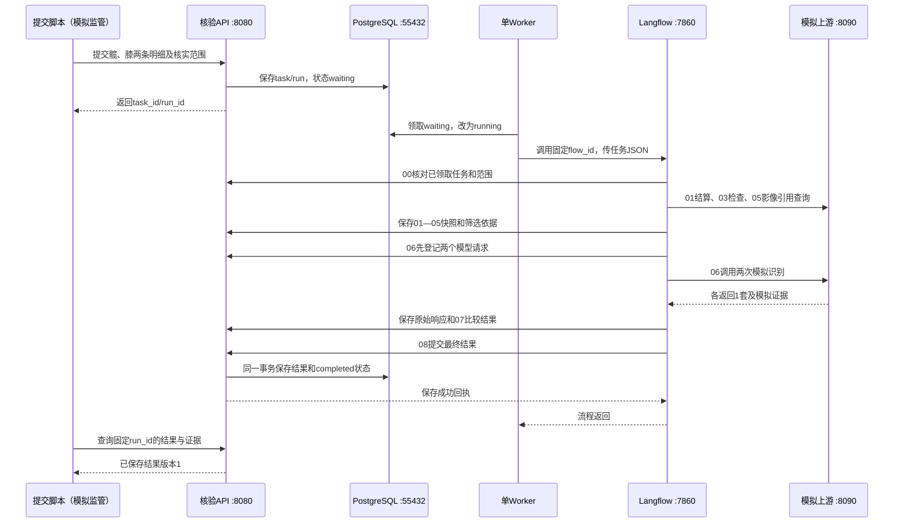

# 完整模拟核验实跑记录

> 下文2026-09-28为旧明细任务的历史记录，不适用于当前三项范围契约。当前启动、规则发布与模拟方法见[README](README.md)，2026-10-07实跑Run为`8820ae67-b70f-4fb5-9ead-332da60dca4d`；结果在`.cache/demo-runs/`，业务API已改8081、数据库55433。

运行时间：2026-09-28 11:05（北京时间）。状态：**completed，08结果保存完成**。

本次运行由模拟监管提交脚本发起，经过独立业务API、PostgreSQL、单Worker、当前源码Langflow的HTTP运行入口、模拟上游和01—08画布流程。没有调用大模型，没有识别真实DICOM。

## 现在在哪里看

- [Langflow流程画布](http://127.0.0.1:3000/flow/170f55a2-2b50-49a1-a1e1-efc5e05b0fea)：查看组件连接、阶段参数及节点执行输出；登录原有verification-admin账号。
- [核验业务API文档](http://127.0.0.1:8080/docs)：提交、状态、结果及证据查询。需要模拟监管Bearer token；提交脚本会自动从私有配置读取。
- [本次提交内容](.cache/demo-runs/fd793fda-aa4e-49b1-8c75-246a64c2f99c/request.json)
- [本次完整结果](.cache/demo-runs/fd793fda-aa4e-49b1-8c75-246a64c2f99c/result.json)
- [本次原始证据](.cache/demo-runs/fd793fda-aa4e-49b1-8c75-246a64c2f99c/evidence.json)

导出文件在本机被Git忽略的`.cache`目录，包含本次合成演示数据，不含访问密钥。平台查询`/api/v1/monitor/builds?flow_id=…`已返回Chat Input及00—08共10个节点的执行记录。业务结果仍以核验API和业务数据库为准。

## 本次输入与输出

监管任务编号：`walkthrough-20260928-001`。

- task_id：`bd343ce7-4548-42ec-ba59-2ddabcf17dcf`
- run_id：`fd793fda-aa4e-49b1-8c75-246a64c2f99c`
- flow_id：`170f55a2-2b50-49a1-a1e1-efc5e05b0fea`
- result_id：`dd1b8e7f-fa23-47d0-a145-44988712c6ba`，版本1

| 合成明细 | 结算数量 | 模拟识别数量 | 结算金额 | 识别数量×结算单价 | 折算差额 | 结论 |
|---|---:|---:|---:|---:|---:|---|
| 人工髋关节 | 2套 | 1套 | 20,000元 | 10,000元 | −10,000元 | difference，供人工复核 |
| 人工膝关节 | 1套 | 1套 | 5,000元 | 5,000元 | 0元 | consistent |

所有识别响应和结果均标记`simulated: true`，模型版本`synthetic-model-v1`。差额定义为折算金额减结算金额，不是基金损失认定。

## 实际调用过程



| 阶段 | 本次行为 | 可核对产物 |
|---|---|---|
| 00入口 | 核对task_id、run_id、已领取状态和明细范围 | 固定运行记录、平台节点执行记录 |
| 01结算快照 | 模拟结算服务返回髋/膝两条明细 | settlement_snapshot |
| 02耗材筛选 | 按医保、耗材标志和目录映射形成两组 | selection |
| 03检查关联 | 按患者、医院、就诊及时间窗查询DR/CT，得到两项DR检查 | studies |
| 04部位初筛 | 根据固定规则和受控样本保留对应检查 | screening |
| 05影像清单 | 查询两个series，共4个虚构影像UID/URL | manifest |
| 06模型识别 | 每组先登记request_id，再调用模拟服务，保存原始响应 | 两条model_request及各自raw_response |
| 07确定性比较 | 比较类别、数量及Decimal费用 | comparison |
| 08结果保存 | 原子保存结果版本1及completed终态 | result、保存回执 |

终端本次实际轮询输出：

```text
status=waiting stage=None event=None
status=running stage=06 event=finished
status=completed stage=08 event=finished
```

领取到结果保存约1.04秒，受理到结果保存约2.32秒。1秒轮询会跳过已很快结束的中间阶段；这些时间只描述本次本地模拟，不代表真实模型性能。业务run表保留最新阶段，不能当作完整阶段事件历史。

## 如何自己再跑一次

服务保持运行，在新终端执行：

```bash
cd /home/huangpan/github_repo/langflow
UV_CACHE_DIR=/tmp/langflow-uv-cache uv run --no-project \
  --python deploy/verification/.cache/runtime/bin/python \
  python scripts/verification/submit_demo.py \
  --reference walkthrough-20260928-002 \
  --output-dir deploy/verification/.cache/demo-runs
```

要观察HTTP调用，另开终端运行：

```bash
cd /home/huangpan/github_repo/langflow
tail -f deploy/verification/.cache/source-ui/api.log \
  deploy/verification/.cache/source-ui/demo.log
```

同一编号重复提交会返回同一个任务，不重复识别。本次已再次提交001并核对数据库：仍为1项任务、1次运行、2条模型请求、6份证据工件和1份结果。换新编号才会创建新的演示任务。不要在画布中直接重复执行已完成的run_id。

## 当前服务与恢复

源码前端3000、平台7860、业务API8080、模拟上游8090、业务PostgreSQL55432和一个Worker均保持运行。平台继续使用原有SQLite库，业务库使用独立verification_app账号连接PostgreSQL17.10；数据库卷保留。停止后按[源码完整模拟启动说明](README.md#在当前源码实例执行完整模拟核验)恢复。
