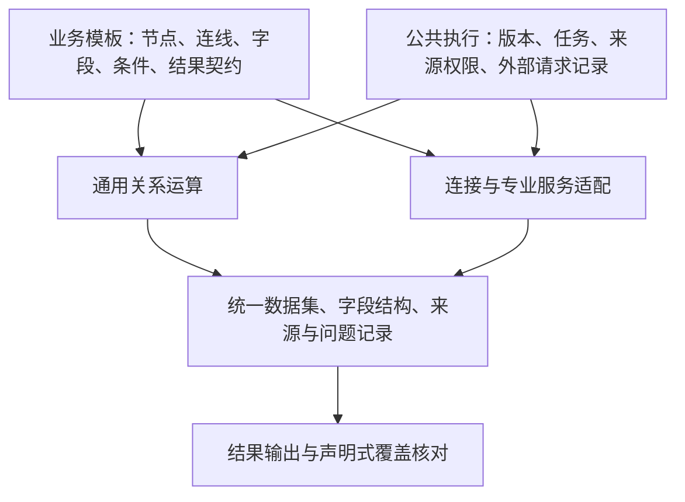

# 通用核验平台：第一性原理审查与消融实验

日期：2026-10-10。审查对象：当前工作区代码、`20260921新架构图diagram.drawio` 的七页图，以及此前提出的 14 类节点清单和截图中的 15 类 Business 节点。图中的旧固定阶段只是需求证据，不作为继续绑定平台的指令。

**结论：PARTIAL。通用数据处理基础值得保留；当前高值耗材模板尚不足以实现图中完整业务。问题集中在业务判定、外部调用记录和结果覆盖的契约，不是节点种类不够多。**

本次只新增隔离实验及报告，没有修改正式执行器、发布规则、业务模板、运行服务或历史数据。已完成 14 项消融/迁移对照和 5 项反例复现。实验断言通过表示观察到了预期因果或缺陷，不能解释为平台通过完整业务验收。

## 1. 从结果倒推必要机制

业务核验至少要回答五个问题：核验什么对象；依据什么记录；记录能否对应；比较前提是否成立；结论与未得结论的原因能否复核。

由此得到的约束，与节点名称无关：

1. **对象与范围确定。** 使用哪个版本、任务参数是什么、哪些来源是待核验明细，哪些是参考目录或证据，必须明确。
2. **事实可追溯。** 输入保存原始记录和稳定身份；转换、关联、分组保留来源关系。处理时选字段不等于删除原始字段。
3. **计算语义确定。** 显式关联键、匹配基数、空值策略、精度、单位、日期口径。读取批次不能成为业务分组边界。
4. **未知不冒充事实。** 范围外、事实缺失、关联冲突、执行失败、业务不同，分别处理。
5. **结论满足前提。** 识别数量是模型观察值；是否可用于与结算比较是另一条规则。类型比较、数量比较、费用比较分别判断前提。
6. **任务结束可核对。** 技术执行完成、业务结论覆盖程度分别记录。依据方案声明的粒度，核对每个应处理对象的最终去向。
7. **执行有固定依据和访问边界。** 任务使用受理时版本，结果按来源授权，外部请求能够关联和核实。

有限实验能反驳不充分方案，不能数学证明任意未来业务都适用，也不能证明某一套节点数量是全局最小值。

## 2. 实验方法和重跑

单一实验目录，不引入新的服务或框架。直接调用生产模块的 SQL 计划、DatasetStore、Langflow 图执行器、任务执行和 ASGI API；移除机制时仅修改内存中的函数副本或临时配置。源码片段替换要求唯一命中，防止被测代码变化后悄悄改错位置。

```bash
cd /home/huangpan/github_repo/langflow
UV_CACHE_DIR=/tmp/langflow-uv-cache uv run --no-project \
  --python deploy/verification/.cache/runtime/bin/python \
  python spikes/001-business-architecture-ablation/main.py
```

- [main.py](./main.py)：可执行实验及断言。
- [memory.py](./memory.py)：独立进程的内存对照。
- [results.json](./results.json)：每项基线、干预结果及结论。
- 所有 SQLite、文件及 Parquet 数据均位于随机临时目录，退出清理。
- 模型使用 HTTP MockTransport 构造确定响应或受理后超时，不访问真实模型。
- 性能数据为单次样本，不给出未经重复采样支持的延迟保证。
- 源码审查与故障注入单列，不把尚未实现的机制写成“已通过消融”。

## 3. 消融结果

| ID | 被移除的机制 | 保留机制 | 移除后 | 可支持的判断 |
|---|---|---|---|---|
| A01 | NULL 独立分流 | 满足/不满足/未知各 1 行 | 不满足变 2 行、未知变 0 行 | 三态语义必要 |
| A02 | 一对一关联约束 | 3 条相关记录进入问题分支 | 产生 2 条“相同”结果，问题 0 条 | 按业务声明匹配基数，不能默认任意多对多 |
| A03 | 跨批次归并 | 同一对象 60+40 汇总为 100 | 分别得到 60、40 | 分批读取仍须全局计算 |
| A04 | 精确数值表示 | 大数金额的 0.01 差异检出 | DOUBLE 比较变成相同 | 精度是数据契约的一部分 |
| A05 | 原始快照留存 | 可查看未参与比较的原始备注 | 最终表不变，原始证据不可再读 | 审计要求独立于数值正确性 |
| A06 | 受理版本固定 | v1 受理任务输出 A、B | 执行时取已启用 v2，只输出 B | 已受理任务不能读取最新规则 |
| A07 | 详情 API 来源检查 | B 查询 A 任务返回 404 | 同一次合法 B 身份查询返回 200 | 身份有效不代表有权读取别人的任务 |
| A08 | 已启动任务重入拦截 | 同任务重复执行被拒，取数 1 次 | 再次取数，累计 2 次 | 顺序重入保护必要；未验证分布式 exactly-once |
| A09 | 识别与覆盖依据门槛 | 覆盖未确认进入问题分支 | 进入可用数据 | 可比性判定不能删除 |
| A10 | 5000 行分批生成 | 百万行 315.4 MiB 峰值 RSS | 全量行列表 703.2 MiB | 分批机制必要；数据引用是当前实现方式 |
| A11 | 调用器内的三项业务判定 | 四夹具可用标记为 1/0/0/0 | 只删除变成 1/1/1/1；移至 Validate 恢复 1/0/0/0 | 需要规则责任，不需要将其绑在 HTTP 调用器中 |
| A12 | 运行时字段类型检查 | 发布整数、实际文本时任务失败 | 任务完成并输出文本，与声明不符 | 发布检查不能替代运行时契约检查 |
| A13 | 任务参数结构检查 | 错误类型及未声明字段被拒 | 错误参数被接收 | 输入结构不能只是页面提示 |
| A14 | Runtime 在 Langflow 调度外再次递归遍历依赖 | 11 节点分支对账图完成，两源各读一次 | 保留 Langflow 调度，直接取已完成前驱输出，结果相同 | 存在可删除的重复遍历责任 |

A02 的夹具业务要求一对一；多对多本身不是错误。A04 使用精度边界反例，不表示每笔普通金额都会受影响。A05 删除的只是临时实验快照。A11 只证明四个夹具的合格/问题划分等价，不证明完整医学判定等价，也未要求问题文案一致。A12 是文件输入的类型漂移实验，不替代真实数据库漂移验收。

A10 在 10 万行、100 万行分别运行两种方式。两边均以 5000 行写入同一个 DatasetStore；记录数、序号求和和生成 Parquet 的 SHA256 全部相同。唯一干预是先生成全量 Python 行列表。通过轻量启动进程隔离主审查进程的内存峰值；被测进程取数前的峰值基线约 289 MiB。分批组从 310.5 MiB 增至 315.4 MiB，全量组从 346.4 MiB 增至 703.2 MiB。时间及准确内存值见 JSON。它验证存储路径的内存行为，不是 MySQL/PostgreSQL 对账或真实影像服务吞吐测试。

A14 没有删除 Langflow 图调度，也未删除节点输出缓存和锁；只移除 Runtime.execute 中重复的递归找前驱。该对账图包含校验分支、汇总、关联、比较和多结果。子流程、并发故障及全部端口组合尚未验证，正式收敛前须扩展这些回归案例。

另外重跑现有业务测试中不依赖本地 HTTP 监听的部分：**12 passed，2 deselected**。两个含本地 HTTP 服务的既有用例未在本次重跑；本次模型故障注入已覆盖自己的控制条件。没有重跑完整前端、真实双库或历史迁移全量测试。

## 4. 当前实现仍被击穿的五个反例

### C01：版本固定的实现范围过宽

`compiler.runtime_digest()` 纳入 business 目录全部 Python 文件及所有插件。仅在内存模拟给 `demo.py` 增加注释，就使已发布任务被拒绝执行。

这是保守策略的兼容性成本，不是错误数据被放行。不能以此为理由删除版本校验。最小处理是将执行构建与演示/管理代码分开，并采用明确的升级排空策略；若要求跨升级继续执行旧任务，则必须保留可运行的旧构建。只保存哈希不能重建旧环境。按节点逐项计算精细依赖图可以以后再做。

定位：`compiler.py:19`、`runtime.py:230`。

### C02：节点全部执行不等于业务覆盖完整

两条来源 A、B，合法筛选节点只将 A 接入结果输出，任务为 completed。B 的 unmatched 数据集仍被保存，**原始数据没有丢失**；但输出没有声明 B 的最终业务去向。

普通 ETL 只需要筛选输出时，这可以是合法设计。核验方案要求逐对象交代结果时，就需要声明覆盖契约，而执行器不能从任意图猜测这个要求。

建议在结果配置声明“核对哪些主数据集、什么身份键、哪些结论维度”，由公共输出机制核对：每个对象是否有排除原因、问题原因、未比较原因或有效结论。参考目录和影像清单不能直接混进业务对象总数。

当前 `unresolved_rows` 是问题分支逐节点计数，接口已经说明可能重复；它不能作为去重后的业务覆盖人数。

定位：`runtime.py:202`、`api.py:364`。

### C03：当前按键去重会采信无业务意义的 UUID 顺序

同一影像 UID 分别对应患者 A、B。Union 按数据集 UUID 取一条，没有冲突分支。保留相同业务记录集合，只交换两个数据集 ID 与记录的对应，最终被采信患者就改变。

两份原始数据仍可查，但原始留存不能弥补错误冲突决策。处理应区分：完全重复可折叠；同键不同事实进入冲突；有明确来源优先级时才按业务规则选择，并保留依据。

首期可以先用现有 Validate 拦截全部重复键，保证不产生伪结论；这会保守拒绝部分可折叠重复。需要自动折叠时再实现明确策略，不急于增加一个新的框架层。

定位：`runtime.py:151`。

### C04：模型远端受理后超时，缺少独立请求关联

模拟远端已受理、本地收到 ReadTimeout。当前保存错误和空响应 `{}`，发送前没有独立 request_id，也没有本次请求与远端任务的持久关联。

节点状态 running 不能代替请求记录；一次节点可调用很多次模型。也不能将超时直接认定为远端失败，更不能据此自动再提交。

最小需要的是公共外部调用记录：提交前保存本地 request_id、实际输入引用及配置版本；有服务任务号则关联；保存受理/未知/成功/失败及原始响应。异步查询只在服务协议支持时使用。平台本地记录无法单方面保证服务端幂等。

这不要求建设自动恢复、分布式调度、持续人工等待或完整检查点系统。

定位：`sources.py:245`。

### C05：确认布尔值不能替代输出有效性

模型返回 `recognized_quantity=-1`，同时返回 coverage_confirmed、recognition_confirmed 为 true 和非空 evidence_ref，当前 Imaging 仍输出可用数据。现有模板没有后置的识别数量非负约束。

这证明调用成功、字段可解析和布尔确认不足以证明结果可用于业务。应先验证专业输出，再分别检查类别、数量、费用的比较前提。专业阈值属于模板或专业组件，通用 Compare 负责确定性字段运算。

定位：`sources.py:260`、`templates.py:215`。

## 5. 图中高值耗材需求与现有模板的差距

当前模板有 **16 个节点实例、9 种类型**；侧栏 15 种类型是能力目录，不能据此说每次流程必须 15 个节点。现有数量示例用固定模拟接口返回识别结果，主比较只有 settled_quantity 与 recognized_quantity。

通用平台允许提供专用节点；不要求每个节点适用于所有业务。边界是：没有选用该专业能力的流程，不应为了它填写专业字段，或在核心执行器中承担它的业务分支和依赖。

| 图中要求 | 当前模板/组件现状 | 应落在哪个边界 |
|---|---|---|
| 医院、医保结算期间及完整明细 | 参数与模拟取数存在；真实 SETL_TIME 字段和接口契约待接入 | 任务参数与数据源节点配置 |
| 结算目录分类并保留未知 | 通用读取、关联、筛选可承担 | 模板中的普通节点组合 |
| 患者、医院、就诊、时间、部位的检查关联 | 当前单次 /business/imaging 调用未显式表达完整证据链 | API、Join、Validate、Filter；复杂专业关系才使用专业组件 |
| 检查→序列→影像 UID/地址清单 | 当前模板没有完整展开这些接口和清单 | API 节点及清单校验 |
| 下载、解码、识别和检查范围内物理对象计数 | 当前为模拟响应 | 专业影像服务或适配组件；不是平台核心写入髋膝分支 |
| 请求关联、异步查询、处理/排除/失败清单 | 缺少完整独立请求记录与清单契约 | 公共调用机制＋专业响应契约 |
| 类别比较 | 专业输出结构没有正式类别结果供模板比较 | 模型结果规范＋独立 Compare 分支 |
| 数量比较 | 已有简化比较，缺完整前提证据 | 专业校验/模板条件＋Compare |
| 费用比较 | 未完成数量、单价、费用及归属的完整流程 | Transform/Aggregate/Validate/Compare 配置；不能任意平均单价 |
| 所有对象最终去向及覆盖缺口 | 可查看中间数据，但未形成最终覆盖核对 | 通用 Output 机制，方案声明对象及维度 |

三种“去重”不可混同：源记录重复、同 UID 影像记录重复、多个视图中的同一实物。前两者依赖记录身份和事实冲突规则；第三种需要经过验证的专业跨图关联能力。按 UID 去重不能证明跨图实物只计数一次。

专业模型输入尽量只提供识别所需证据、目标类别与计数口径。当前把 settled_quantity 作为 quantity_field 发给模型，是否必要要由模型接口契约解释；独立识别测试应屏蔽结算期待数量，防止产生答案依赖。本次未检验真实模型是否利用了该字段，不能断言已经发生泄漏。

## 6. 收敛后的节点目录与最小性

**最小性应定义为：对已经明确的数据源契约和验收案例，再删除某项责任，就会破坏业务正确性、可追溯性或资源约束。不能用“看起来节点少”来定义。**

对未经专业预处理的原始结算及外部影像服务，一个合理的初始目录如下；是否出现、出现几次由数据契约决定：

| 节点能力 | 唯一主要责任 | 高值耗材中的配置示例 | 是否必然独立出现 |
|---|---|---|---|
| Parameters | 声明、校验任务输入 | 医院、期间 | 输入契约必需；可表现为流程属性，不必每图占一个计算节点 |
| Database / API | 根据固定连接和查询契约读取数据 | 结算、目录、检查、影像清单 | 按数据源选择；并非两者都必须 |
| Transform | 显式转换字段及计算派生值 | 单位规范化、金额计算 | 源字段已满足要求时可省 |
| Validate | 检查数据能否继续处理并说明原因 | 主键、类型、重复键、模型输出范围 | 责任必需，可分布在多个位置 |
| Filter | 按三态条件决定业务分支 | 医保支付、耗材事实、髋膝类别、检查窗口 | 按模板范围配置 |
| Join | 建立记录对应关系及标明未匹配/冲突 | 结算↔目录、对象↔检查、结果↔核实依据 | 上游已提供可信关联时可减少 |
| Aggregate | 按声明的业务对象汇总并保留成员 | 一次就诊、类别、单位的数量 | 输入已经是同口径单元时可省 |
| 专业服务调用/Imaging 适配 | 提交证据并取得有状态、有版本的专业观察值 | CT/DR 识别 | 使用影像识别时需要；专业算法不放进通用平台 |
| Compare | 在前提满足的数据上比较字段 | 类别、数量、费用，各自状态 | 可重复使用；不自己查询影像或替模型证明覆盖 |
| Output | 持久结果、声明展示结构并核对覆盖 | 结论、未比较、排除、问题与证据入口 | 需要可查询任务结果时必需 |

如果全部数据来自 API、字段无需转换，上表可用九种类型组合；需要 Transform 则增加一种。它只是条件化的组合示例，不是已经验收的最小节点数。费用、类别、数量等分支会复用节点，因此实例数通常大于类型数。

File、文本 Model、Union、Subflow 都作为可选能力保留；分别在文件输入、文本推断、多源追加、复用已发布流程时使用。缺少它们不必然阻断高值耗材流程。大模型不承担确定性求和、相等比较或为缺失事实补答案。

复杂模板可以包装成子流程降低画布配置负担，内部仍保留清晰节点边界；子流程不是新的必经业务阶段。

## 7. 高内聚、低耦合的最小实现方向

继续单部署，按职责划分代码，不为此次审查引入微服务、消息总线或通用插件框架的第二套实现。



边界要求：

- **通用关系运算**只接收字段结构、数据集引用和配置，不知道医院、髋、膝或 DICOM。复用现有 DuckDB 实现，不重写为逐行 Python。
- **适配层**知道数据库/API/模型协议及输入输出格式；专业识别是一个明确的能力，不等于通用字段比较。模型请求持久记录是公共执行责任，不给每个专业插件单独造一套任务系统。
- **模板与专业规则**定义对象对应、范围、可比性和结果含义。调用器保留专业观察值；Validate/Filter 或确有专业算法的组件计算是否可比较。
- **公共执行**固定版本、授权、存储与调用状态，不按业务名称选择执行路径。凭据不复制进节点和版本包。
- **图调度**由 Langflow 负责；业务执行层承担节点操作和持久记录。A14 支持移除额外的递归前驱遍历，先以当前分支对账图为证据，再补子流程等回归后实施。
- **输出**按方案声明核对覆盖。业务规则由画布定义，发布页只展示摘要，不再维护第二份可编辑条件。

A11 已支持把当前 Imaging 内的简单判定移到现有 Validate；不需要新增一套“规则引擎”。但它没有验证真实影像计量规则，复杂部位/范围分析应在专业组件中返回可审计结果，而不能简单替成一个手填 true。

节点之间存在数据依赖是正常的。低耦合的判断标准是：换一个连接、模型或业务条件，是否只改对应适配或配置，其他节点是否仍遵守同一数据契约。不是要求节点互相完全不知道输入输出，也不是把每个 if 都拆成一个节点。

## 8. Langflow 自带节点如何使用

以本工作区代码为准，未经适配不能直接与 Business 数据集引用混用；发布器只接受已注册能力，原生 Data/DataFrame 不自动具备当前的快照与版本契约。

| 自带能力 | 可以复用什么 | 当前不能直接代替什么 |
|---|---|---|
| SQL Executor | SQL 查询/连接相关已有代码 | 当前 `fetchall()` 构造全量 DataFrame，不能作为百万行分批快照读取器 |
| API Request | HTTP 请求配置和基础传输 | 逐业务对象的持久请求关联、部分失败、空响应和异步任务状态 |
| Table/DataFrame Operations | 小数据转换及部分计算 | 默认内存 DataFrame、索引关联/同名列处理不等同于业务键、基数、冲突和来源契约 |
| 条件路由 | 小数据真/假分支 | 必须区别 false 与 unknown 的业务筛选 |
| Structured Output/模型组件 | 提示词、模型调用、结构化解析 | 真实 CT/DR 识别、跨图实物计数和临床可比性证明 |
| Run Flow | 子流程交互及复用界面 | Business 已发布子流程版本的固定执行契约 |

优先复用已有实现并包一层真正满足契约的适配；若适配内部仍全量 fetchall，再返回一个引用，并没有解决内存问题。不能为了“统一使用原生节点”放弃经实验支持的语义。

源码依据：`sql_executor.py:94`、`dataframe_operations.py:406`、`data_conditional_router.py:43`、`run_flow.py:78`、`business/components.py:126`。

## 9. 建议执行顺序与尚待验证项

1. **先阻止错误结论：** 识别输出合法性；键冲突不能任意选一条；分别声明类别、数量、费用的比较前提和覆盖契约。
2. **再收紧职责：** 专业调用保留观察值，简单判定迁入现有 Validate/Filter；补最小外部请求记录；明确构建升级/旧任务排空策略。
3. **最后补真实模板和适配：** 三段影像接口、真实分类来源、专业输出与计量证据、费用归属；用同一通用运行机制执行。

尚未通过本次实验验证的关键专业能力：检查与就诊真实关联正确率、影像清单完整性、跨视图实物计数、类别识别准确率、计量单位与范围确认、数量到费用的明确归属。这些需要真实接口契约、已核实样本及独立的专业验收；不能用本次 Mock 响应替代。

### Verdict: PARTIAL

- **已验证：** 列明数据正确性、输入契约、版本、权限和分批机制的移除会造成具体退化；四个夹具支持把简单业务门槛移出模型调用函数；11 节点对账图支持消除重复依赖遍历。
- **未通过当前方案审查：** 模型输出负值、模型请求关联缺口、冲突去重的任意选择、核验覆盖契约缺口；版本校验还有明显的升级耦合成本。
- **意外发现：** 固定版本与“旧版本持续可运行”不是一回事；全部节点 completed 与业务对象已得到处理也不是一回事。
- **正式实现建议：** 保留现有通用基础，针对上述边界做局部改造。先满足不可删减的责任，再决定画布节点数量；不把 14/15 类节点清单当作已经获证的最终架构。
